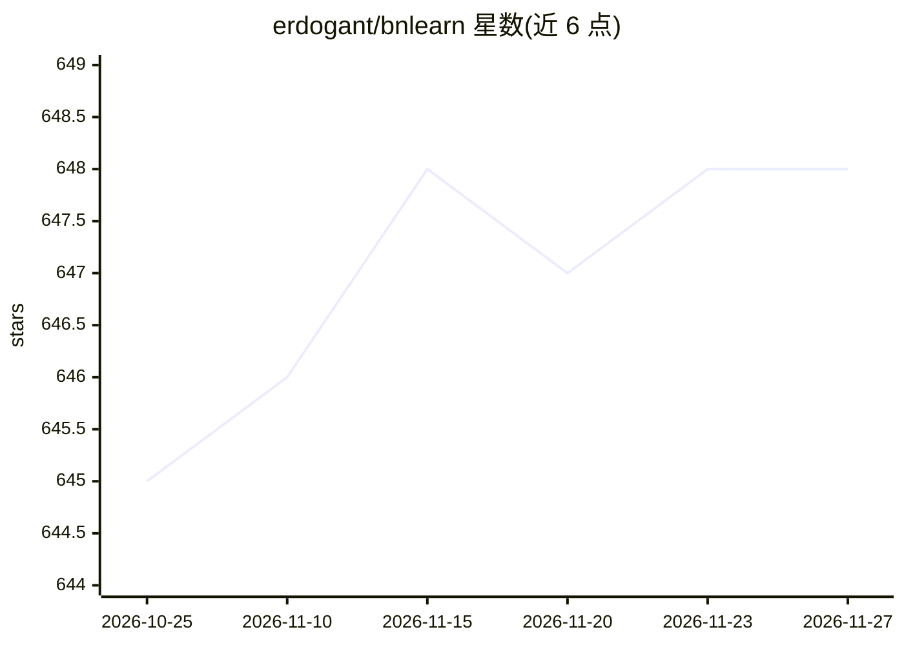

# erdogant/bnlearn

⭐ 648 · Jupyter Notebook · NOASSERTION · 推送 2026-11-22 · [GitHub](https://github.com/erdogant/bnlearn) · [官网](https://erdogant.github.io/bnlearn) · 个人维护

**贝叶斯网络因果发现 Python 库：结构/参数学习、推断与采样**

bnlearn 是用于因果发现的 Python 包，通过从数据中学习贝叶斯网络的图结构、参数估计、贝叶斯推断与采样方法开展工作。它将常用流程封装为简洁 API：结构学习、参数学习、干预与反事实推断、合成数据生成、连续数据离散化，支持离散/连续/混合数据类型，并提供绘图、DAG 与邻接矩阵转换、模型保存加载等辅助函数。安装要求 Python 3.10 以上，提供 uv、pip、conda 与源码多种安装途径，附示例笔记本、Colab 与 API 文档。

## 筛选速览

| 维度 | 判定 | 备注 |
|---|---|---|
| AI 角色 | `ai-native` | 本体是模型或模型工具 |
| 许可风险 | `none` | NOASSERTION |
| 部署形态 | `library` | 以包/库形式分发 |
| 模型依赖 | — | README 未给出锁定关系 |
| 硬件要求 | — | 无带数字的原话,不猜 |
| 安装摩擦 | `low` | 无编译、无系统依赖或容器化 |
| 成熟度 | — | 结构信号不足 |

## 能力要点

- 结构学习、参数学习、推断、预测、采样的统一 API
- 支持离散、连续和混合数据类型建模
- DAG 与邻接矩阵/向量等多种格式转换函数
- 提供与 LLM 因果发现方法的基准对比材料

## 适用场景

- 从观测数据学习贝叶斯网络结构并估计参数
- 计算干预与反事实分布做因果推断
- 用贝叶斯采样生成合成数据
- 对连续数据集离散化后做贝叶斯网络建模

## 场景标签

 · 领域:机器学习/因果推断

## 证据(README 行号)

> L19: ``bnlearn`` is Python package for causal discovery by learning the graphical structure of Bayesian networks, parame
> L27: |**Structure Learning**|Learn the model structure from data or with expert knowledge.|link|Podcast|

## 星数曲线

2026-10-25 645 → 2026-11-27 648（+3）

---
*卡片 v1 · prompt 1.4 · 生成 2026-11-24 · 置信度 high · 依据 README sha `42cb53ffd661` · [字段定义](../../DATASET.md)*
