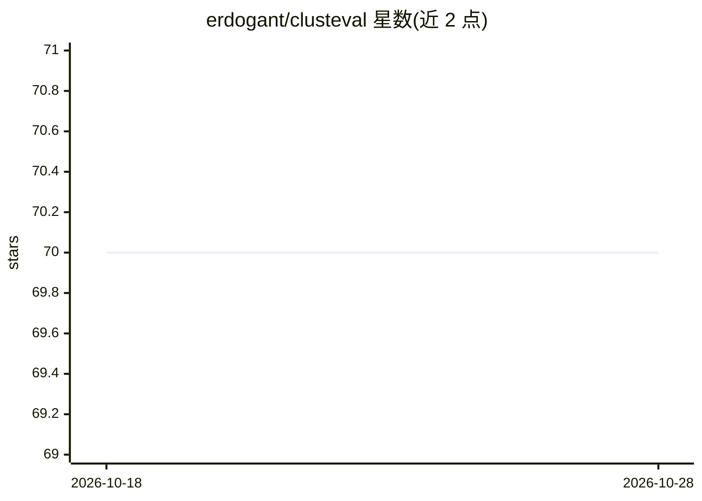

# erdogant/clusteval

⭐ 70 · Jupyter Notebook · NOASSERTION · 推送 2026-02-21 · [GitHub](https://github.com/erdogant/clusteval) · [官网](https://erdogant.github.io/clusteval) · 个人维护

**无监督聚类验证的 Python 库：评估簇质量并返回最优簇标签**

Python 库，用于评估检测到的聚类并返回在聚类倾向、簇数量和聚类质量上最优的簇标签。实现 silhouette、dbindex、derivative 三种评估策略，支持 agglomerative、kmeans、dbscan、hdbscan 四种聚类方法，可输出轮廓系数图、最优簇数、树状图等结果。通过 PyPI 以 pip 安装，建议在 conda 虚拟环境中使用；由个人维护者 Erdogan Taskesen 开发，提供完整文档与引用信息，面向研究与数据分析场景。

## 筛选速览

| 维度 | 判定 | 备注 |
|---|---|---|
| AI 角色 | `ai-native` | 本体是模型或模型工具 |
| 许可风险 | `none` | NOASSERTION |
| 部署形态 | `library` | 以包/库形式分发 |
| 模型依赖 | — | README 未给出锁定关系 |
| 硬件要求 | — | 无带数字的原话,不猜 |
| 安装摩擦 | `low` | 无编译、无系统依赖或容器化 |
| 成熟度 | — | 结构信号不足 |

## 能力要点

- silhouette / dbindex / derivative 三种评估策略
- 支持 agglomerative / kmeans / dbscan / hdbscan 四种聚类方法
- 自动确定最优簇数量并返回簇标签

## 适用场景

- 我不确定数据该聚成几类，用它自动寻找最优簇数
- 对比多种聚类方法并评估聚类质量
- 科研论文中需要对聚类结果做验证与可视化

## 场景标签

 · 领域:机器学习/聚类验证

## 证据(README 行号)

> L20: ``clusteval`` is a python package that is developed to evaluate detected clusters and return the cluster labels tha

## 星数曲线

2026-10-18 70 → 2026-10-28 70（+0）

---
*卡片 v1 · prompt 1.4 · 生成 2026-10-24 · 置信度 high · 依据 README sha `0b3b9e79edee` · [字段定义](../../DATASET.md)*
