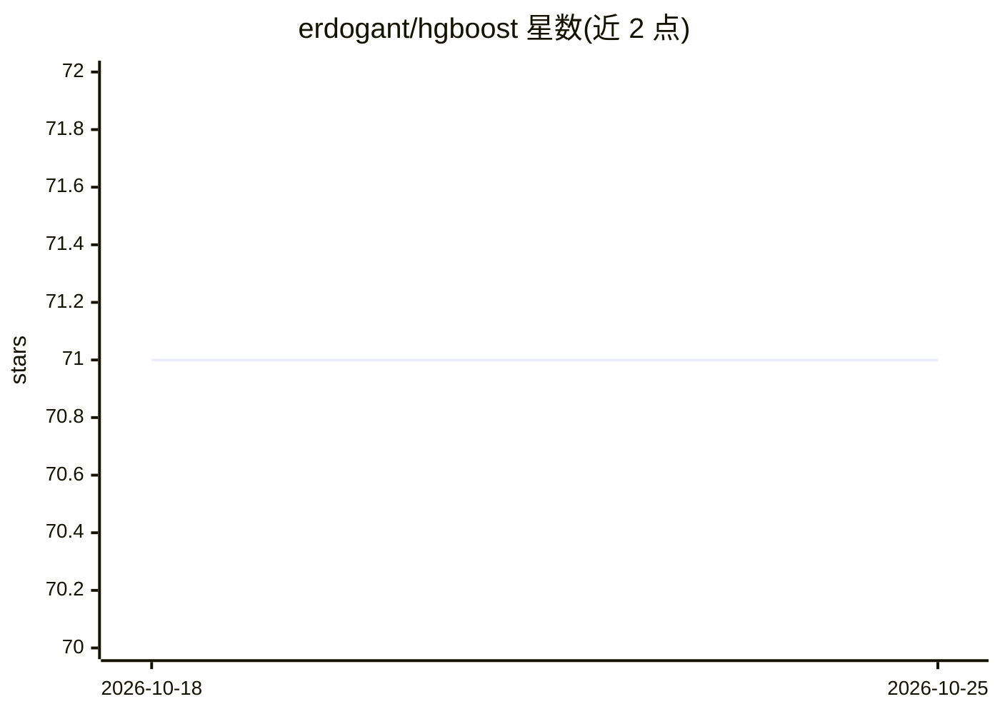

# erdogant/hgboost

⭐ 71 · Python · NOASSERTION · 推送 2026-05-15 · [GitHub](https://github.com/erdogant/hgboost) · [官网](http://erdogant.github.io/hgboost) · 个人维护

**xgboost/catboost/lightboost 的贝叶斯超参数优化 Python 包**

面向分类与回归任务的 Python 库：对 xgboost、catboost、lightboost 三种梯度提升模型做基于贝叶斯方法的超参数空间搜索，用 k-fold 交叉验证选出最优模型，并在独立验证集上评估，最后用最优参数在全量数据上拟合；支持将各模型优化结果集成为 super-hyperoptimized 模型，返回模型、参数空间与测试结果，并生成可视化图表（参数空间、验证与交叉验证结果、树图）。基于 hyperopt 实现，提供 pip 安装与 Colab 示例笔记本。

## 筛选速览

| 维度 | 判定 | 备注 |
|---|---|---|
| AI 角色 | `ai-ecosystem` | LLM/agent 周边工具 |
| 许可风险 | `none` | NOASSERTION |
| 部署形态 | `library` | 以包/库形式分发 |
| 模型依赖 | — | README 未给出锁定关系 |
| 硬件要求 | — | 无带数字的原话,不猜 |
| 安装摩擦 | `low` | 无编译、无系统依赖或容器化 |
| 成熟度 | — | 结构信号不足 |

## 能力要点

- 对 xgboost/catboost/lightboost 做贝叶斯超参数优化
- k-fold 交叉验证选优 + 独立验证集评估
- 可将各单独优化模型集成为 ensemble 模型
- 输出参数空间、验证结果等可视化图表

## 适用场景

- 给梯度提升模型自动调参并避免过拟合
- 用交叉验证系统比较 xgboost/catboost/lightboost 表现
- 将多个优化模型集成为一个分类/回归模型

## 场景标签

 · 领域:机器学习/超参数优化

## 证据(README 行号)

> L16: ``hgboost`` is short for **Hyperoptimized Gradient Boosting** and is a python package for hyperparameter optimizati
> L21:  * 1. Hyperoptimization of the Parameter-space using bayesian approach.
> L22:  * 2. Determines the best scoring model(s) using k-fold cross validation.

## 星数曲线

2026-10-18 71 → 2026-10-25 71（+0）

---
*卡片 v1 · prompt 1.4 · 生成 2026-10-24 · 置信度 high · 依据 README sha `54c8ae3a265c` · [字段定义](../../DATASET.md)*
