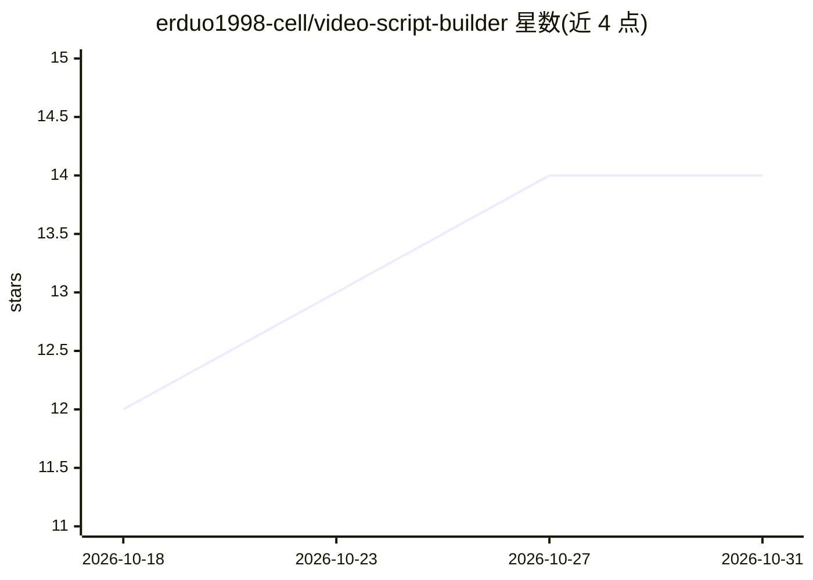

# erduo1998-cell/video-script-builder

⭐ 14 · Python · MIT · 推送 2026-10-10 · [GitHub](https://github.com/erduo1998-cell/video-script-builder) · 个人维护 · 中文 README

**把中文视频逐字稿转为程序化视频分镜规格的 Agent Skill**

面向支持 Skill 的 AI Agent（Claude Code、Codex）的技能包：读取中文口播逐字稿，拆出叙事节拍、情绪曲线与时间轴，生成意图卡、素材清单，并输出绑定 HyperFrames 或 Remotion 之一的 Markdown 分镜规格（video-spec-hf.md / video-spec-remotion.md），通过 12 条硬阻断检查。一次任务只交付一份 spec，不渲染视频、不安装依赖、不生成 TSX 或 MP4；API key、Node.js、FFmpeg 均非必需。安装方式为 git clone 到 skills 目录，另提供可选的作者付费会员资料服务（MIT 下使用无需购买）。

## 筛选速览

| 维度 | 判定 | 备注 |
|---|---|---|
| AI 角色 | `ai-native` | 本体是模型或模型工具 |
| 许可风险 | `permissive` | MIT |
| 部署形态 | `library` | 以包/库形式分发 |
| 模型依赖 | — | README 未给出锁定关系 |
| 硬件要求 | — | 无带数字的原话,不猜 |
| 安装摩擦 | `medium` | 含编译或系统依赖之一 |
| 成熟度 | — | 结构信号不足 |

## 能力要点

- 双后端分镜契约：HyperFrames（组件+GSAP 秒制）与 Remotion（React 组件+整数帧）
- 12 条硬阻断检查框架绑定、时间闭合、动画确定性与交接完整度
- 10 节语义骨架 spec，支持跨框架迁移且不覆盖原文件
- 无需 API key 与 Node.js/FFmpeg，git clone 安装即可使用

## 适用场景

- 我有口播逐字稿，想让 Agent 规划镜头、字幕、转场与素材安排
- 给 HyperFrames 或 Remotion 渲染 Agent 准备可执行的分镜规格
- 把已有 HyperFrames spec 迁移为 Remotion 版本

## 场景标签

 · 领域:视频制作/AI Agent 工具

## 证据(README 行号)

> L37: `video-script-builder` 会让支持 Skill 的 AI Agent：
> L44: - 最终只生成当前框架对应的一份 Markdown 分镜规格。

## 星数曲线

2026-10-18 12 → 2026-10-31 14（+2）

---
*卡片 v1 · prompt 1.4 · 生成 2026-10-31 · 置信度 mid · 依据 README sha `c196be1b0b43` · [字段定义](../../DATASET.md)*
