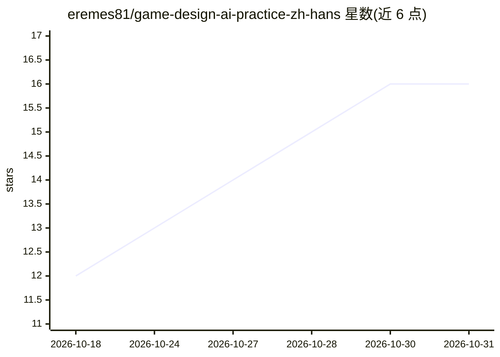

# eremes81/game-design-ai-practice-zh-hans

⭐ 16 · HTML · NOASSERTION · 推送 2026-10-30 · [GitHub](https://github.com/eremes81/game-design-ai-practice-zh-hans) · [官网](https://eremes81.github.io/game-design-ai-practice-zh-hans/) · 个人维护 · 中文 README

**免费电子书：游戏策划实务中活用 Claude Code 的实战手册**

由游戏行业 24 年经历的李旼洙撰写的实战手册简体中文版（韩语原书 ISBN 979-11-12-12-21479-9 的翻译，876 页、24 部分、100 章），以 Markdown 源文在 GitHub 发布，许可 CC BY-NC-SA 4.0。内容覆盖安装、记忆/权限配置、系统/战斗/关卡/叙事设计、数值平衡、QA、Live Ops、会议记录转决策、成本与版权治理等，声称正文数字均来自真实工作、多数代码仅依赖 Python 标准库。中文版由本书自身的 AI 工作流翻译并经作者审阅，附 MIT 许可的 Harness Starter Kit 工具包。

## 筛选速览

| 维度 | 判定 | 备注 |
|---|---|---|
| AI 角色 | `ai-knowledge` | 知识聚合/清单类 |
| 许可风险 | `none` | NOASSERTION |
| 部署形态 | `None` |  |
| 模型依赖 | — | README 未给出锁定关系 |
| 硬件要求 | — | 无带数字的原话,不猜 |
| 安装摩擦 | `low` | 无编译、无系统依赖或容器化 |
| 成熟度 | — | 结构信号不足 |

## 能力要点

- 24 部分 + 附录 A–N 共 100 章的 Markdown 全文免费发布
- 覆盖系统/战斗/关卡设计、数值平衡、QA、运营、会议决策等实务工作流
- 附录含 MCP 服务器目录、移植其他 LLM/驱动框架、15 周教学进度表
- 附带 MIT 许可的 Harness Starter Kit（记忆·钩子·复盘结构工具包）

## 适用场景

- 游戏策划者学习将 Claude Code 引入日常制作工作
- 按阅读路线自学从安装配置到长期运营的完整流程
- 非游戏行业读者参考会议决策、质量验证等通用 AI 工作流

## 场景标签

`教程课程` · 领域:学习与行业

## 证据(README 行号)

> L20: 这是一位在游戏行业深耕 24 年的策划总监所写的实战手册，讲的是如何把生成式 AI（Claude Code）真正带进**每天的制作工作**。不是理论，也不是预测——它一次只推进一项任务，从最初的那块屏幕（安装、账号、计费）开始，一
> L22: 副标题——**「没有一个数字是编造的」**——是这本书的承诺。正文里的每一个数字、每一个案例都来自真实的工作，而不是编造的示例；而且大部分代码仅凭 Python 标准库就能原样跑起来。

## 星数曲线

2026-10-18 12 → 2026-10-31 16（+4）

---
*卡片 v1 · prompt 1.4 · 生成 2026-10-30 · 置信度 high · 依据 README sha `1378a0de4226` · [字段定义](../../DATASET.md)*
