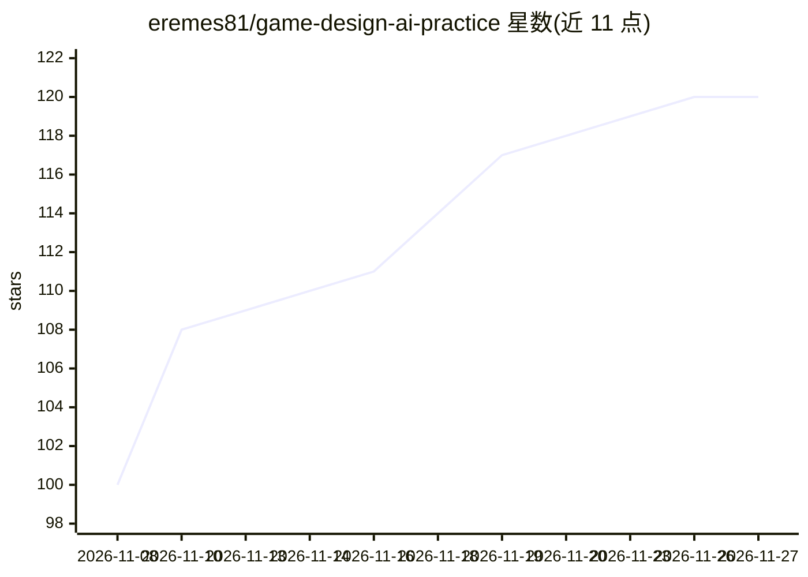

# eremes81/game-design-ai-practice

⭐ 120 · HTML · NOASSERTION · 推送 2026-10-30 · [GitHub](https://github.com/eremes81/game-design-ai-practice) · [官网](https://bookk.co.kr/bookStore/6a298be0ff49b1a6034c7703) · 个人维护

**韩国语图书原稿：游戏策划实务中使用 Claude Code 的方法**

24年经历的游戏策划者/设计总监撰写的实战指南，主题为在游戏策划日常工作中使用生成式 AI（Claude Code）。覆盖从安装、账号、费用设置到系统设计、战斗、叙事、关卡、平衡、UX、上线运营，以及会议记录转决策、验证关卡、成本管理、版权伦理等流程；24 部加附录 A~N 共 100 章，876 页。本仓库公开该书韩国语版 Markdown 原稿，另有英/日/泰/印尼/中等多语言版本；纸质书与电子书通过出版平台销售。代码示例多依赖 Python 标准库。

## 筛选速览

| 维度 | 判定 | 备注 |
|---|---|---|
| AI 角色 | `ai-knowledge` | 知识聚合/清单类 |
| 许可风险 | `none` | NOASSERTION |
| 部署形态 | `None` |  |
| 模型依赖 | — | README 未给出锁定关系 |
| 硬件要求 | — | 无带数字的原话,不猜 |
| 安装摩擦 | `low` | 无编译、无系统依赖或容器化 |
| 成熟度 | — | 结构信号不足 |

## 能力要点

- 覆盖系统/战斗/叙事/关卡/平衡/UX/运营等游戏策划全流程的 AI 工作流
- 24 部 + 附录 A~N + 终章，共 100 章、876 页
- 提供多语言版本（英/日/泰/印尼/简中/繁中）
- 配套『harness starter kit』（记忆·钩子·回顾结构，MIT 许可）可下载使用

## 适用场景

- 游戏策划者学习将 Claude Code 引入日常设计工作
- 参考会议记录转决策、验证关卡、AI 成本管理等治理流程
- 团队负责人制定 AI 引入策略与说服管理层

## 场景标签

`教程课程` · 领域:学习与行业

## 证据(README 行号)

> L24: 24년 차 게임 기획자이자 디자인 디렉터가, 생성형 AI(Claude Code)를 **매일의 실무**에 들이는 법을 정리한 실전 안내서입니다. 이론이나 전망이 아니라 설치·계정·요금 같은 첫 화면부터 시스템
> L50: 종이책(₩61,600)과 PDF 전자책(₩15,000) 모두 부크크에서 구매할 수 있습니다. 이 저장소는 같은 책의 **한국어판 원고(마크다운 소스)**를 라이선스에 따라 공개한 것입니다.

## 星数曲线

2026-11-08 100 → 2026-11-27 120（+20）

---
*卡片 v1 · prompt 1.4 · 生成 2026-11-18 · 置信度 high · 依据 README sha `736e06f35b39` · [字段定义](../../DATASET.md)*
