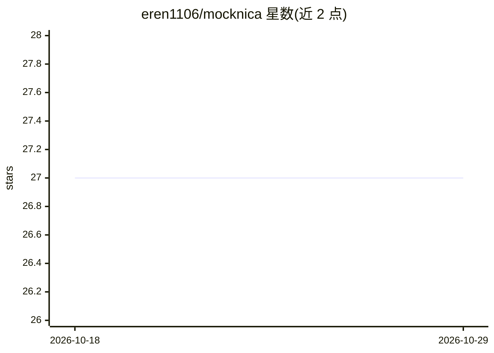

# eren1106/mocknica

⭐ 27 · TypeScript · MIT · 推送 2026-01-03 · [GitHub](https://github.com/eren1106/mocknica) · [官网](https://mocknica.dev) · 个人维护

**面向前端开发者的自托管 Mock API 服务器，支持 LLM 生成接口**

基于 Next.js/TypeScript/PostgreSQL 的全栈 Mock API 平台：用户定义可复用数据 Schema 后自动生成 CRUD 端点，mock API 即建即用，支持多项目隔离、Bearer Token 认证、CORS 配置与响应包装模板。AI 部分：可用 GPT、Gemini 或本地 Ollama 模型生成 Schema 与端点。通过 pnpm 源码安装或 Docker 一键部署（含 app、PostgreSQL、Redis），需 Node.js v18+、pnpm v10+，Google OAuth 登录为可选配置。

## 筛选速览

| 维度 | 判定 | 备注 |
|---|---|---|
| AI 角色 | `ai-enhanced` | 去掉 AI 部分产品仍成立 |
| 许可风险 | `permissive` | MIT |
| 部署形态 | `self-host` | docker 或自建部署 |
| 模型依赖 | local-ok | 支持本地模型 |
| 硬件要求 | — | 无带数字的原话,不猜 |
| 安装摩擦 | `low` | 无编译、无系统依赖或容器化 |
| 成熟度 | — | 结构信号不足 |

## 能力要点

- Schema 定义后自动生成完整 CRUD REST 端点
- LLM（GPT/Gemini/Ollama）生成 Schema 与端点
- 多项目隔离、Bearer Token 认证、CORS 配置、响应包装模板
- Docker 一键部署完整栈（app/PostgreSQL/Redis）

## 适用场景

- 后端 API 未就绪时先行构建和测试前端界面
- 用受控 mock 数据测试 QA 边界场景
- 快速搭建带真实感数据的演示应用
- 在实现前设计与迭代 API 契约

## 场景标签

`代码生成` · 领域:编码与开发

## 证据(README 行号)

> L5: An AI-Powered Open-Source Mock API Server that enables users to self-host, manage, and run mock APIs with ease.
> L21: - **🤖 AI-Powered Generation** - Generate schemas and endpoints using LLM like GPT, Gemini, or local Ollama models

## 星数曲线

2026-10-18 27 → 2026-10-29 27（+0）

---
*卡片 v1 · prompt 1.4 · 生成 2026-10-26 · 置信度 mid · 依据 README sha `b9d68ac87d79` · [字段定义](../../DATASET.md)*
