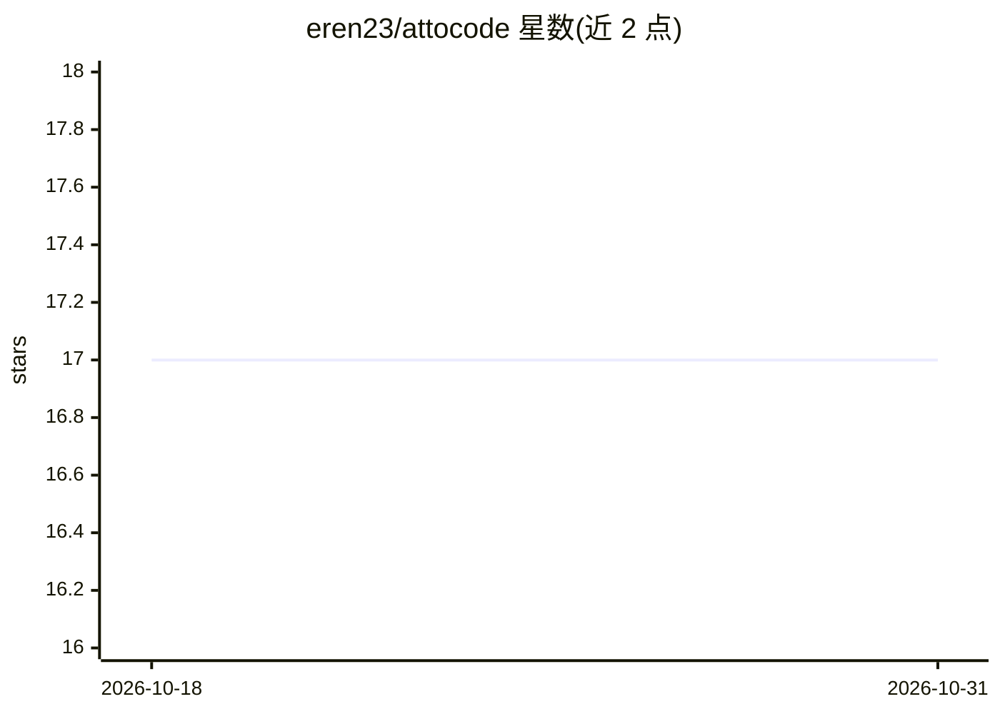

# eren23/attocode

⭐ 17 · Python · MIT · 推送 2026-10-30 · [GitHub](https://github.com/eren23/attocode) · 个人维护

**面向 MCP 编码客户端的代码库理解引擎**

attocode-code-intel 是为 Codex、Claude Code、Cursor 等 MCP 客户端提供代码库理解能力的引擎：通过 bootstrap、符号搜索、引用、依赖与影响分析、变更调查（changes/trace）等 MCP 工具，在 token 预算内返回相关代码与结构。AST 导航与关键词搜索无需模型 API key；本地嵌入搜索、图分析为可选。支持单仓库工作树运行，也可自托管团队服务（PostgreSQL、Redis、Streamable HTTP MCP、仪表盘），共享带出处的学习知识。旧编码 agent 与教学课程已归档。

## 筛选速览

| 维度 | 判定 | 备注 |
|---|---|---|
| AI 角色 | `ai-ecosystem` | LLM/agent 周边工具 |
| 许可风险 | `permissive` | MIT |
| 部署形态 | `None` |  |
| 模型依赖 | — | README 未给出锁定关系 |
| 硬件要求 | — | 无带数字的原话,不猜 |
| 安装摩擦 | `low` | 无编译、无系统依赖或容器化 |
| 成熟度 | — | 结构信号不足 |

## 能力要点

- bootstrap 在 token 预算内返回相关代码、结构与召回知识
- changes/trace 变更调查：diff、调用者证据、导入影响与候选测试
- 自托管团队服务：PostgreSQL 知识库、鉴权、仪表盘与 cross_repo_search
- AST 导航与关键词搜索无需模型 API key

## 适用场景

- 给 Codex/Claude Code/Cursor 等 agent 接入代码库导航与影响分析
- 团队自托管服务分析已提交仓库并共享学习知识
- 变更前调查：diff 结合调用者与导入影响定位候选测试

## 场景标签

 · 领域:开发者工具/代码智能

## 证据(README 行号)

> L3: Codebase understanding for **Codex, Claude Code, Cursor, and other MCP clients**. Run it on your working tree, or co
> L5: The intelligence engine now lives in `packages/code-intel` and ships as **`attocode-code-intel`**, independently of 

## 星数曲线

2026-10-18 17 → 2026-10-31 17（+0）

---
*卡片 v1 · prompt 1.4 · 生成 2026-10-29 · 置信度 high · 依据 README sha `9bba467ac3b8` · [字段定义](../../DATASET.md)*
