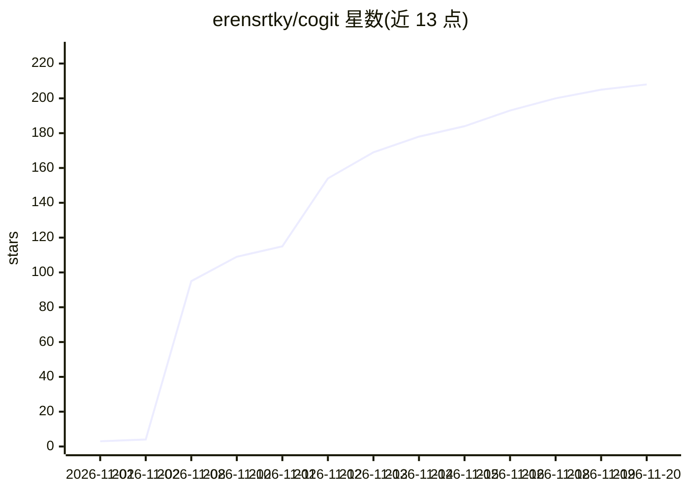

# erensrtky/cogit

⭐ 208 · TypeScript · MIT · 推送 2026-11-19 · [GitHub](https://github.com/erensrtky/cogit) · [官网](https://www.npmjs.com/package/@cogit/cli) · 个人维护

**记录 AI 编码代理决策意图的工具：把每条消息变成可追溯的 thought commit**

以插件形式运行在 Claude Code 与 Codex CLI 中的记录工具：通过代理的 hooks 在工作过程中把用户消息、结果、决策与被否决的选项写成 thought commit，代码提交带有 Thought: trailer，可用 cogit why/show/blame 追溯任意代码的存在原因。附带会话地图（git 图形式的对话视图）、任务捕获（小模型在会话结束时记录未完成工作，默认关闭）、含决策的 PR 描述生成，以及通过 git 在团队间共享记录（无服务器、无账号，敏感模式脱敏）。记录由小模型在后台完成，约每 20 条消息成本低于 2 美分。需 Node 22.13+，npm 全局安装。

## 筛选速览

| 维度 | 判定 | 备注 |
|---|---|---|
| AI 角色 | `ai-ecosystem` | LLM/agent 周边工具 |
| 许可风险 | `permissive` | MIT |
| 部署形态 | `library` | 以包/库形式分发 |
| 模型依赖 | locked-api |  |
| 硬件要求 | — | 无带数字的原话,不猜 |
| 安装摩擦 | `low` | 无编译、无系统依赖或容器化 |
| 成熟度 | — | 结构信号不足 |

## 能力要点

- 每条代理消息记录为 thought commit，含决策理由与被否决选项
- 代码提交带 Thought: trailer，cogit why/show/blame 追溯意图
- 会话地图：git 图形式的对话视图，支持 Resume 与 Fork
- cogit pr 生成包含决策的 PR 描述，可挂 GitHub Action 自动发布

## 适用场景

- 我在多个项目同时跑多个编码代理，事后想找回每段代码为什么这样写
- 代码评审时让 reviewer 看到变更背后的决策与被否决的选项
- 团队成员通过 git 拉取共享彼此的代理会话记录

## 场景标签

 · 领域:开发者工具/AI 编码工作流

## 证据(README 行号)

> L21: It runs as a plugin in your coding agent and works through its hooks, so the record is written
> L15: cogit records every message you send to an AI coding agent as a *thought commit*: what you

## 星数曲线

2026-11-01 3 → 2026-11-20 208（+205）

---
*卡片 v1 · prompt 1.4 · 生成 2026-11-17 · 置信度 high · 依据 README sha `1b1d3aed91da` · [字段定义](../../DATASET.md)*
