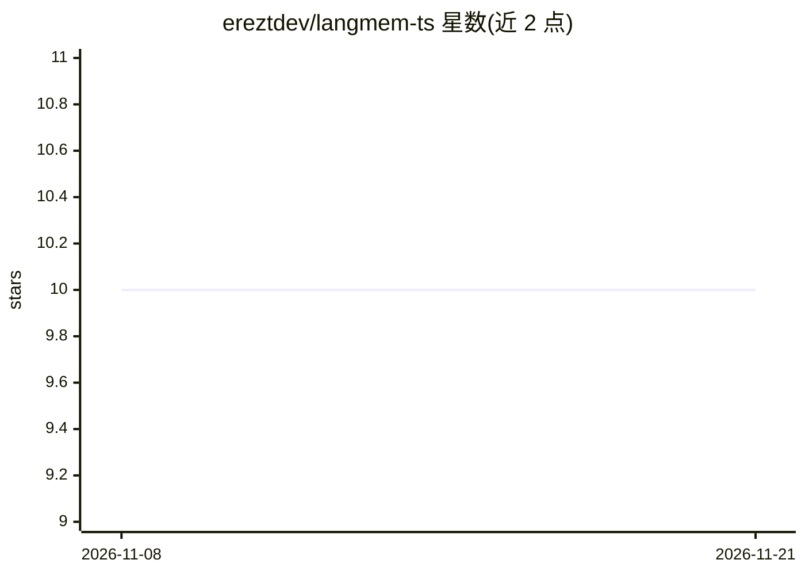

# ereztdev/langmem-ts

⭐ 10 · TypeScript · MIT · 推送 2026-04-21 · [GitHub](https://github.com/ereztdev/langmem-ts) · 个人维护

**TypeScript AI agent 记忆库：提取→嵌入→存储→检索**

面向 TypeScript agent 的记忆原语库，实现 extract→embed→store→retrieve 流水线，以 Postgres+pgvector 为参考后端。四个接口（Embedder/Store/Retriever/Extractor）各有默认 OpenAI+Postgres 实现，可整体替换；配置构造时注入，不读环境变量。当前为早期版本 0.1.0，仅支持语义记忆提取，情景记忆、去重、命名空间等列于路线图。MIT 许可，通过 npm 安装。

## 筛选速览

| 维度 | 判定 | 备注 |
|---|---|---|
| AI 角色 | `ai-ecosystem` | LLM/agent 周边工具 |
| 许可风险 | `permissive` | MIT |
| 部署形态 | `self-host` | docker 或自建部署 |
| 模型依赖 | — | README 未给出锁定关系 |
| 硬件要求 | — | 无带数字的原话,不猜 |
| 安装摩擦 | `low` | 无编译、无系统依赖或容器化 |
| 成熟度 | `idea` | |

## 能力要点

- extract→embed→store→retrieve 四接口流水线，各组件可替换
- Postgres+pgvector 参考后端，接口层设计支持其他存储
- 启动时校验嵌入维度，不匹配即报错
- 框架无关，不绑定 LangGraph

## 适用场景

- 给 TypeScript AI agent 加长期记忆存储与向量检索
- 自托管 Postgres 保存用户对话事实
- 替换嵌入器或存储后端定制记忆方案

## 场景标签

`Agent 记忆` · 领域:Agent 开发

## 证据(README 行号)

> L5: **TypeScript first class memory primitive for AI agents.**
> L15: `extract → embed → store → retrieve` over any Postgres + pgvector backend.
> L92: - **Framework-agnostic.** No LangGraph coupling. Works inside any TypeScript agent or plain script.

## 星数曲线

2026-11-08 10 → 2026-11-21 10（+0）

---
*卡片 v1 · prompt 1.4 · 生成 2026-11-20 · 置信度 mid · 依据 README sha `191faa8e9f28` · [字段定义](../../DATASET.md)*
