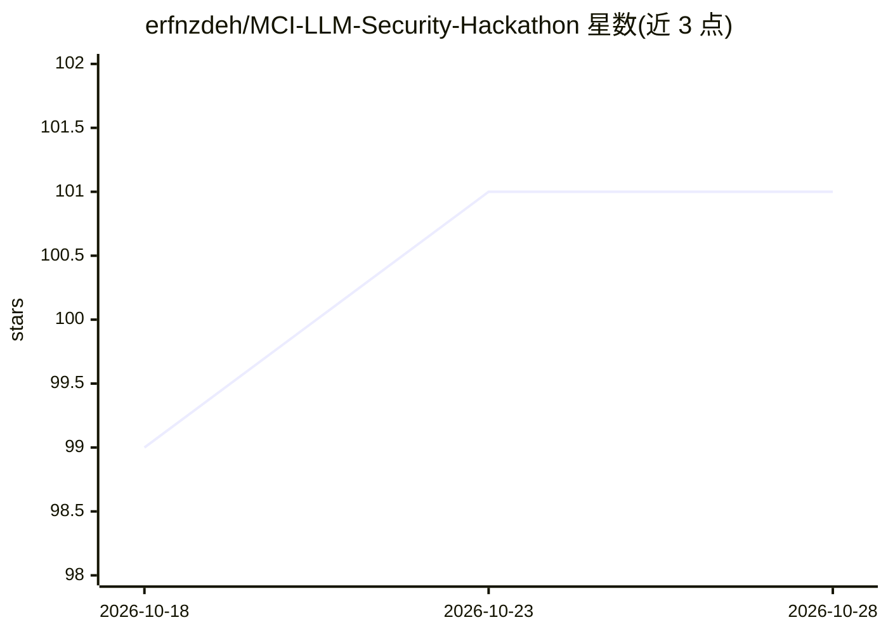

# erfnzdeh/MCI-LLM-Security-Hackathon

⭐ 101 · Jupyter Notebook · 推送 2026-08-08 · [GitHub](https://github.com/erfnzdeh/MCI-LLM-Security-Hackathon) · 个人维护

**MCI LLM 安全黑客松参赛日记：越狱攻击全过程存档**

团队 Prompt Police 参加 2025 年 11 月 Quera 平台上 MCI（伊朗运营商）Secure-AI 黑客松的个人存档，自述非产品非工具包。内容含三份文档：逐日日记、真实越狱技术日志（跨语言、音译、波斯语键盘密码、经印地语中转等手法）、官方赛事事实，另附决赛当日冻结的 ipywidgets 作战控制台 notebook 与截图。赛制为对三个带领域防护的聊天模型，在 14 个禁区各打一发评分，队伍预赛进入决赛、第二轮并列第 19。

## 筛选速览

| 维度 | 判定 | 备注 |
|---|---|---|
| AI 角色 | `ai-knowledge` | 知识聚合/清单类 |
| 许可风险 | `none` | — |
| 部署形态 | `None` |  |
| 模型依赖 | — | README 未给出锁定关系 |
| 硬件要求 | — | 无带数字的原话,不猜 |
| 安装摩擦 | `low` | 无编译、无系统依赖或容器化 |
| 成熟度 | — | 结构信号不足 |

## 能力要点

- 记录真实越狱手法：跨语言路由（印地语中转）、Finglish 音译、QWERTY↔波斯语键盘密码、虚构框架
- 附决赛当日冻结的 ipywidgets 作战控制台（solution.ipynb）
- ATTACKS.md 逐条收录真实提示词、命中领域与得分情况

## 适用场景

- 研究者查阅 LLM 安全防护的越狱攻击实例记录
- 了解该赛事的赛制、评审与结果事实
- 参考 ipywidgets 探针控制台的搭建方式

## 场景标签

 · 领域:LLM 安全/对抗攻击

## 证据(README 行号)

> L5: > A personal archive of team **Prompt Police**'s run through the MCI «هوش امن» (Secure-AI) Hackathon on Quera — Nov 
> L12: |🧨 `ATTACKS.md`|The technical log — the actual jailbreak techniques we used, the real prompts we fired, which domai
> L22: MCI (همراه اول) ran a **red-team** hackathon: they stood up three chat models behind a safety **domain guard**, and

## 星数曲线

2026-10-18 99 → 2026-10-28 101（+2）

---
*卡片 v1 · prompt 1.4 · 生成 2026-10-23 · 置信度 high · 依据 README sha `55297d59b431` · [字段定义](../../DATASET.md)*
