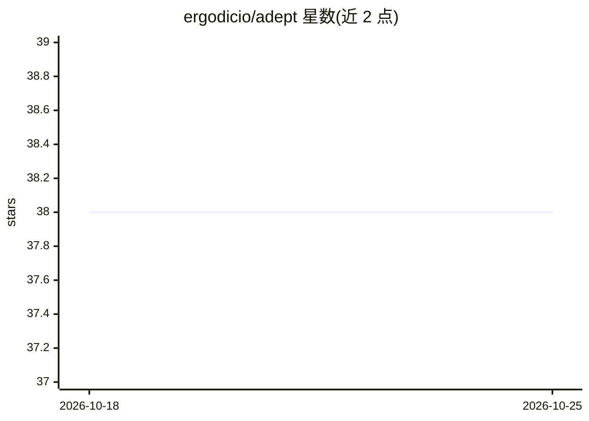

# ergodicio/adept

⭐ 38 · Python · MIT · 推送 2026-10-24 · [GitHub](https://github.com/ergodicio/adept) · 个人维护

**JAX 编写的可微等离子体输运模拟代码**

ADEPT 是基于 JAX 的自动微分等离子体输运仿真代码，用 diffrax 做时间积分，使整个模拟端到端可微，可在 CPU 或 GPU 上运行，运行记录写入 MLflow。提供 10 类求解器，覆盖 Vlasov-Poisson/Maxwell、Vlasov-Fokker-Planck 电子输运、激光等离子体包络、粒子云胞、暖双流体等物理模型，配置文件驱动运行。也可作为神经网络训练管线中的可微仿真组件使用。通过 uv 安装，需 Python 3.11+，GPU 需额外同步 jax[cuda12]。

## 筛选速览

| 维度 | 判定 | 备注 |
|---|---|---|
| AI 角色 | `ai-native` | 本体是模型或模型工具 |
| 许可风险 | `permissive` | MIT |
| 部署形态 | `library` | 以包/库形式分发 |
| 模型依赖 | — | README 未给出锁定关系 |
| 硬件要求 | — | 无带数字的原话,不猜 |
| 安装摩擦 | `low` | 无编译、无系统依赖或容器化 |
| 成熟度 | — | 结构信号不足 |

## 能力要点

- JAX + diffrax 实现端到端可微仿真，CPU/GPU 均可运行
- 10 类求解器覆盖 Vlasov、Fokker-Planck、PIC、包络与双流体模型
- 运行记录写入 MLflow，可浏览器查看结果
- 可作为神经网络训练管线中的可微仿真组件

## 适用场景

- 运行动理学等离子体输运仿真（Vlasov/Fokker-Planck 等）
- 利用可微仿真训练神经网络学习强迫函数或隐藏变量
- 对不同初始/边界条件做参数扫描并记录实验

## 场景标签

 · 领域:计算物理/等离子体模拟

## 证据(README 行号)

> L8: ADEPT is an **A**utomatic **D**ifferentiation **E**nabled **P**lasma **T**ransport code.
> L10: The solvers are written in JAX and time-integrated with
> L11: diffrax, so every simulation is differentiable end-to-end and runs on

## 星数曲线

2026-10-18 38 → 2026-10-25 38（+0）

---
*卡片 v1 · prompt 1.4 · 生成 2026-10-25 · 置信度 high · 依据 README sha `538627587c3a` · [字段定义](../../DATASET.md)*
