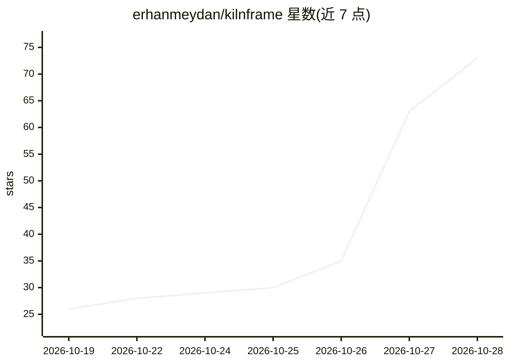

# erhanmeydan/kilnframe

⭐ 73 · TypeScript · Apache-2.0 · 推送 2026-10-25 · [GitHub](https://github.com/erhanmeydan/kilnframe) · [官网](https://kilnframe.com) · 个人维护

**把口述内容变成动画插片与配乐的视频剪辑插件**

面向 Adobe Premiere Pro 与 DaVinci Resolve Studio 的免费开源插件：用户在时间线标记入出点，插件本地转录语音，让所连接的视觉 LLM 规划场景（图表、示意图、3D 隐喻、大字排版），以 HTML/CSS/JS 生成动画，经 HyperFrames 在本机渲染并连同合成音效放上时间线。音乐功能通过 Google Lyria 分段生成分主题配乐。AI 接入支持 Claude Code、Codex、Grok 订阅或 Claude/OpenAI/Gemini/xAI/MiniMax/OpenRouter API key，也可用 LM Studio 本地模型；音频视频不离开本地。要求带 GPU 的电脑、Premiere 2026 或 Resolve Studio 21.1+，免费版 Resolve 不支持。

## 筛选速览

| 维度 | 判定 | 备注 |
|---|---|---|
| AI 角色 | `ai-native` | 本体是模型或模型工具 |
| 许可风险 | `permissive` | Apache-2.0 |
| 部署形态 | `desktop` | 安装包/桌面程序 |
| 模型依赖 | locked-api |  |
| 硬件要求 | — | 无带数字的原话,不猜 |
| 安装摩擦 | `medium` | 含编译或系统依赖之一 |
| 成熟度 | — | 结构信号不足 |

## 能力要点

- 语音转录→LLM 场景规划→HTML/CSS/JS 动画→本地渲染的完整流程
- 11 种预设视觉风格，渲染前逐场景静态帧审批
- Google Lyria 分段生成配乐并自动压低人声下电平
- API key 存于系统钥匙串，渲染/语音识别/音效均在本地运行

## 适用场景

- 为口述讲解视频自动生成信息图/动态字幕插片
- 给整条视频按话题分段生成配乐
- 用自己的 LLM 订阅或 API key 在本地流程中生成动画

## 场景标签

`语音识别` `视频生成` · 领域:内容生成

## 证据(README 行号)

> L10: Kilnframe is a free, open source plugin for Adobe Premiere Pro and DaVinci Resolve Studio. You mark an in/out range
> L13: HTML, CSS and JavaScript animation, renders it on your own computer with
> L25: - **Your plan or your key.** Use Claude Code, Codex or Grok with your own subscription, or an API key.

## 星数曲线

2026-10-19 26 → 2026-10-28 73（+47）

---
*卡片 v1 · prompt 1.4 · 生成 2026-10-25 · 置信度 high · 依据 README sha `46b8b5e3c66c` · [字段定义](../../DATASET.md)*
