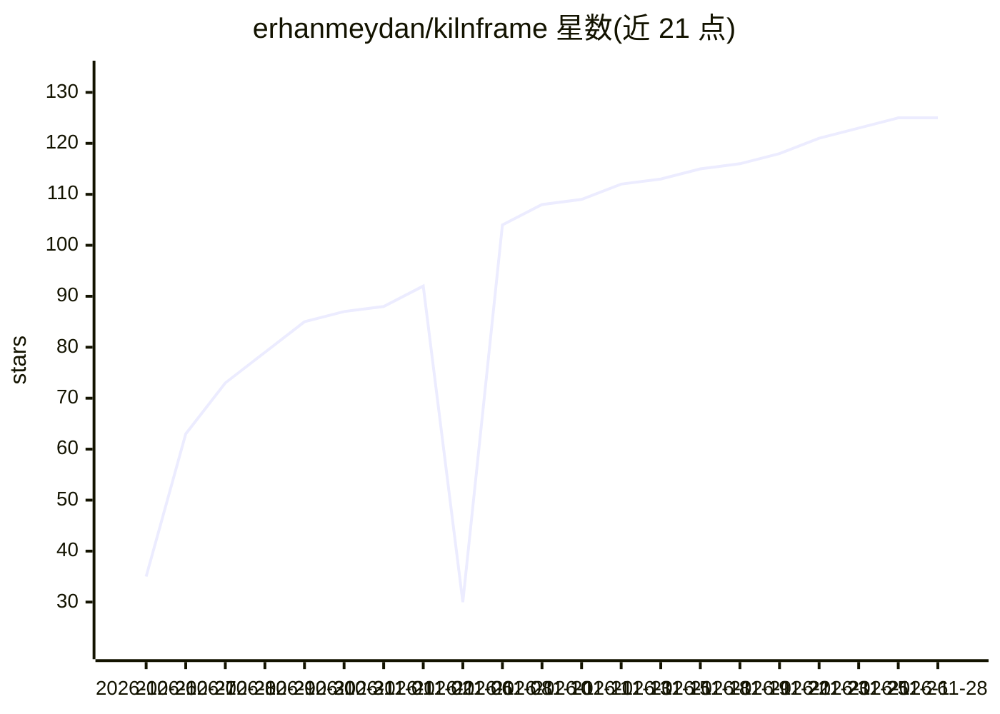

# erhanmeydan/kilnframe

⭐ 125 · HTML · Apache-2.0 · 推送 2026-11-23 · [GitHub](https://github.com/erhanmeydan/kilnframe) · [官网](https://kilnframe.com) · 个人维护

**为 Premiere/Resolve 生成动态插图与配乐的插件**

面向 Adobe Premiere Pro、DaVinci Resolve Studio 和开源编辑器 FilmCraft 的插件：用户在时间线标记区间后，插件监听区间内语音，按内容规划场景（图表、流程图、3D 比喻、大字排版），以 HTML/CSS/JavaScript 编写动画并用 HyperFrames 在本地渲染，将视频与合成音效放置到时间线上。提供 11 种预设样式、逐场景静帧预览与重做、Google Lyria 配乐、本地语音识别生成字幕。渲染、语音识别与音效合成本地执行，仅文本与少量静帧发送到所选模型。提供 macOS/Windows 安装包。

## 筛选速览

| 维度 | 判定 | 备注 |
|---|---|---|
| AI 角色 | `ai-native` | 本体是模型或模型工具 |
| 许可风险 | `permissive` | Apache-2.0 |
| 部署形态 | `desktop` | 安装包/桌面程序 |
| 模型依赖 | local-ok | 支持本地模型 |
| 硬件要求 | — | 无带数字的原话,不猜 |
| 安装摩擦 | `medium` | 含编译或系统依赖之一 |
| 成熟度 | — | 结构信号不足 |

## 能力要点

- 按语音内容规划并生成 HTML/CSS/JS 动画场景，本地渲染后插入时间线
- Google Lyria 按主题分段配乐并自动 ducking 至独立音轨
- 支持订阅 CLI（Claude Code/Codex/Grok Build）、多家 API key 或 LM Studio/Ollama 本地视觉模型
- 音频视频文件不离开本机，语音识别与渲染本地运行

## 适用场景

- 为讲解视频自动生成与旁白内容匹配的动画插图
- 为整段时间线或选区生成跟随话题的背景配乐
- 从语音生成样式化字幕并导出 SRT

## 场景标签

`视频生成` `语音识别` · 领域:内容生成

## 证据(README 行号)

> L10: Kilnframe is a free, open source plugin for Adobe Premiere Pro and DaVinci Resolve Studio, and it also works with t
> L12: for a process, a 3D metaphor for an idea, big type for a strong sentence), writes each scene as an
> L13: HTML, CSS and JavaScript animation, renders it on your own computer with

## 星数曲线

2026-10-26 35 → 2026-11-28 125（+90）

---
*卡片 v1 · prompt 1.4 · 生成 2026-11-28 · 置信度 high · 依据 README sha `61b1f7a4be42` · [字段定义](../../DATASET.md)*
