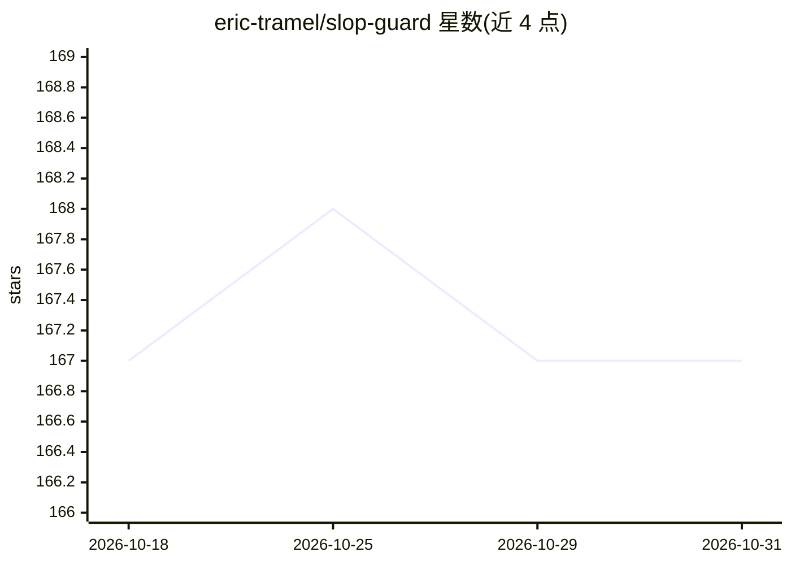

# eric-tramel/slop-guard

⭐ 167 · Python · MIT · 推送 2026-07-09 · [GitHub](https://github.com/eric-tramel/slop-guard) · [官网](https://eric-tramel.github.io/blog/2026-02-18-slop-guard/) · 个人维护

**规则式文风检查器：给文本的 AI 套话程度打分**

纯程序化散文检查工具，按 24 条可配置规则与 200+ 字面/结构启发式对文本打 0-100 分，输出分数、分级标签、违规项与修改建议；不调用 LLM、不需 API key。提供 sg 命令行（支持文件/stdin/内联文本、JSON 输出、阈值与退出码）、sg-fit 从语料拟合规则配置，以及 MCP 服务器（check_slop / check_slop_file），可加入 Claude Code、Codex 等 agent 客户端。文本不足 10 词返回满分。安装依赖 uv（uvx / uv tool install）。

## 筛选速览

| 维度 | 判定 | 备注 |
|---|---|---|
| AI 角色 | `ai-ecosystem` | LLM/agent 周边工具 |
| 许可风险 | `permissive` | MIT |
| 部署形态 | `None` |  |
| 模型依赖 | — | README 未给出锁定关系 |
| 硬件要求 | — | 无带数字的原话,不猜 |
| 安装摩擦 | `low` | 无编译、无系统依赖或容器化 |
| 成熟度 | — | 结构信号不足 |

## 能力要点

- 24 条规则、200+ 启发式的 0-100 打分与分级（clean 到 saturated）
- 无 LLM 判定、无 API 调用、无网络请求的纯规则实现
- MCP 服务器模式，可用 `uvx slop-guard` 加入 Claude Code / Codex
- sg-fit 可从自有语料拟合自定义规则 JSONL

## 适用场景

- 给 AI 辅助写作的稿件做套话程度检查并按阈值把关
- 在 Claude Code 或 Codex agent 中作为 MCP 工具实时检查输出文风
- 批量 lint 项目 Markdown 文档中的 AI 痕迹

## 场景标签

 · 领域:开发工具/文本处理

## 证据(README 行号)

> L5: A rule-based prose linter that scores text 0--100 for formulaic AI writing patterns. No LLM judge, no API calls. Pur
> L11: Both clients use the same MCP command: `uvx slop-guard`.
> L206: ## MCP Tools

## 星数曲线

2026-10-18 167 → 2026-10-31 167（+0）

---
*卡片 v1 · prompt 1.4 · 生成 2026-10-23 · 置信度 high · 依据 README sha `5c7281ef6651` · [字段定义](../../DATASET.md)*
