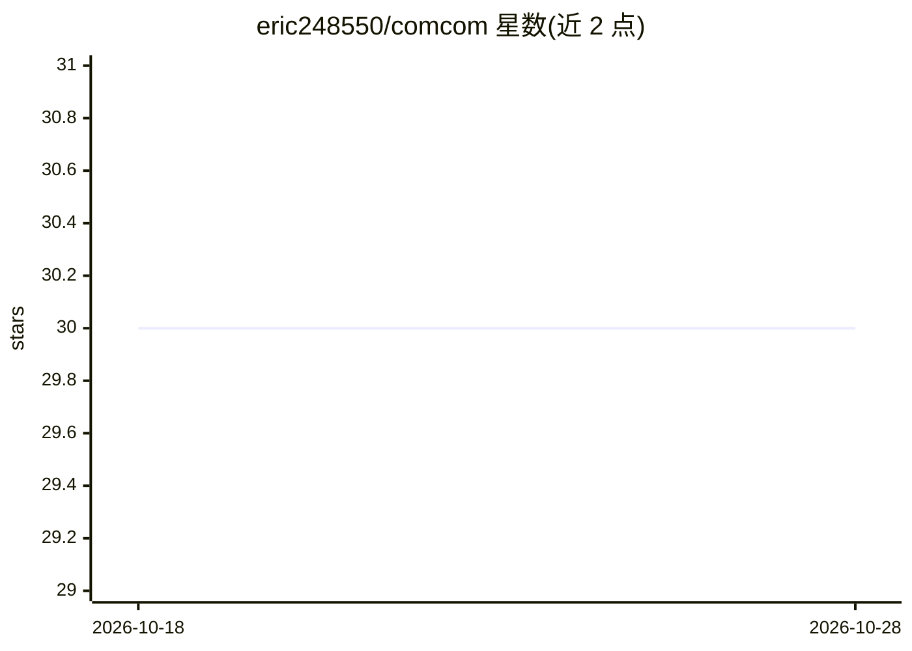

# eric248550/comcom

⭐ 30 · TypeScript · MIT · 推送 2026-06-17 · [GitHub](https://github.com/eric248550/comcom) · [官网](https://comcomweb.vercel.app/) · 个人维护

**Gmail/Slack 内的 AI 文本改写工具栏：选中文本选模式即改写**

可自托管的 Chrome 扩展 + SaaS 单仓项目（Turborepo/pnpm）。扩展在 Gmail 撰写窗注入工具栏，选中文本后按 improve/shorten/expand/formal/casual 模式或自定义提示模板调用 OpenAI（gpt-4o-mini）改写，支持 SSE 流式输出；Next.js 仅作前端仪表盘（提示模板、组织写作语气、写作历史、统计），业务逻辑位于 Cloudflare Worker，数据存 Neon PostgreSQL（Prisma），认证用 Clerk。架构预留 Slack/LinkedIn 等平台扩展点。自托管需 Node.js>=20、pnpm、Cloudflare、Clerk 与 OpenAI API key。

## 筛选速览

| 维度 | 判定 | 备注 |
|---|---|---|
| AI 角色 | `ai-native` | 本体是模型或模型工具 |
| 许可风险 | `permissive` | MIT |
| 部署形态 | `library` | 以包/库形式分发 |
| 模型依赖 | — | README 未给出锁定关系 |
| 硬件要求 | — | 无带数字的原话,不猜 |
| 安装摩擦 | `low` | 无编译、无系统依赖或容器化 |
| 成熟度 | — | 结构信号不足 |

## 能力要点

- Gmail 工具栏选中文本即时 AI 改写（5 种模式）
- 按用户/组织自定义提示模板与基线写作语气
- SSE 流式改写与写作历史记录（含 token 用量）
- Chrome 扩展已上架 Chrome Web Store，可完全自托管

## 适用场景

- 在 Gmail 撰写邮件时快速改写、缩写或调整语气
- 团队统一组织写作风格并共享提示模板
- 自托管一套内部 AI 写作辅助服务并留存写作历史

## 场景标签

`AI 写作` · 领域:内容生成

## 证据(README 行号)

> L13: A self-hostable Chrome Extension + SaaS monorepo that injects an AI communication toolbar into Gmail and Slack. Sel
> L24: - **Gmail toolbar** — select text in any compose window, get instant AI rewrites (improve, shorten, expand, formal,
> L94: |AI|OpenAI API (gpt-4o-mini)|

## 星数曲线

2026-10-18 30 → 2026-10-28 30（+0）

---
*卡片 v1 · prompt 1.4 · 生成 2026-10-26 · 置信度 mid · 依据 README sha `cdbee0cfc9b6` · [字段定义](../../DATASET.md)*
