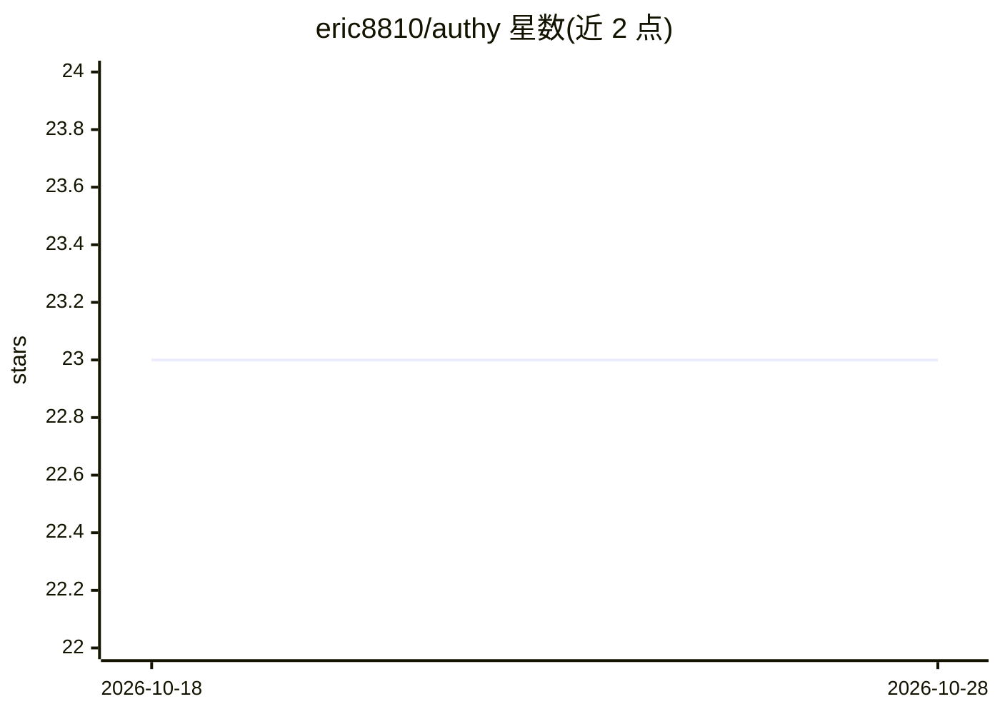

# eric8810/authy

⭐ 23 · Rust · MIT · 推送 2026-02-26 · [GitHub](https://github.com/eric8810/authy) · [官网](https://authy.scotares.com) · 个人维护

**面向 AI agent 的本地加密密钥库与分发 CLI**

单二进制 Rust CLI，本地加密存储密钥，通过 `authy run` 将密钥以环境变量注入子进程、`authy resolve` 渲染配置模板，支持按 glob 范围的策略授权、只注入不可读取的 run-only 模式、短时会话令牌与 HMAC 链式审计日志。可作 MCP server 暴露 5 个工具给 Claude Desktop、Cursor 等 agent 平台，并提供 Python/Node 原生绑定（内嵌 Rust 引擎）、Go 子进程封装、Rust crate 与管理 TUI。无需服务器。

## 筛选速览

| 维度 | 判定 | 备注 |
|---|---|---|
| AI 角色 | `ai-ecosystem` | LLM/agent 周边工具 |
| 许可风险 | `permissive` | MIT |
| 部署形态 | `library` | 以包/库形式分发 |
| 模型依赖 | — | README 未给出锁定关系 |
| 硬件要求 | — | 无带数字的原话,不猜 |
| 安装摩擦 | `low` | 无编译、无系统依赖或容器化 |
| 成熟度 | — | 结构信号不足 |

## 能力要点

- age(X25519) 加密存储，密钥仅注入子进程环境，不落 shell 历史与 .env
- glob 策略授权与 run-only 模式：agent 可注入但不可读取明文
- MCP server 暴露 get_secret/list_secrets 等 5 个工具（stdio JSON-RPC 2.0）
- Python/Node 原生绑定内嵌 Rust 引擎，另提供 Go 封装、Rust crate 与 TUI

## 适用场景

- 让 AI 编码 agent 安全调用 API 而不接触密钥明文
- 用可提交的占位符模板在部署时渲染真实配置
- 为不同 agent/项目按策略隔离密钥访问范围并留审计日志

## 场景标签

 · 领域:开发工具/密钥管理

## 证据(README 行号)

> L3: Encrypted secrets for AI agents. Single binary, no server, no accounts.
> L31: Run Authy as an MCP (Model Context Protocol) server for AI agent platforms like Claude Desktop, Cursor, and Windsur
> L46: Exposes 5 tools over stdio JSON-RPC 2.0: `get_secret`, `list_secrets`, `store_secret`, `remove_secret`, `test_polic
> L184: Works with Claude Code, Cursor, OpenClaw, and 38+ AI coding agents:

## 星数曲线

2026-10-18 23 → 2026-10-28 23（+0）

---
*卡片 v1 · prompt 1.4 · 生成 2026-10-27 · 置信度 high · 依据 README sha `285e490320c8` · [字段定义](../../DATASET.md)*
