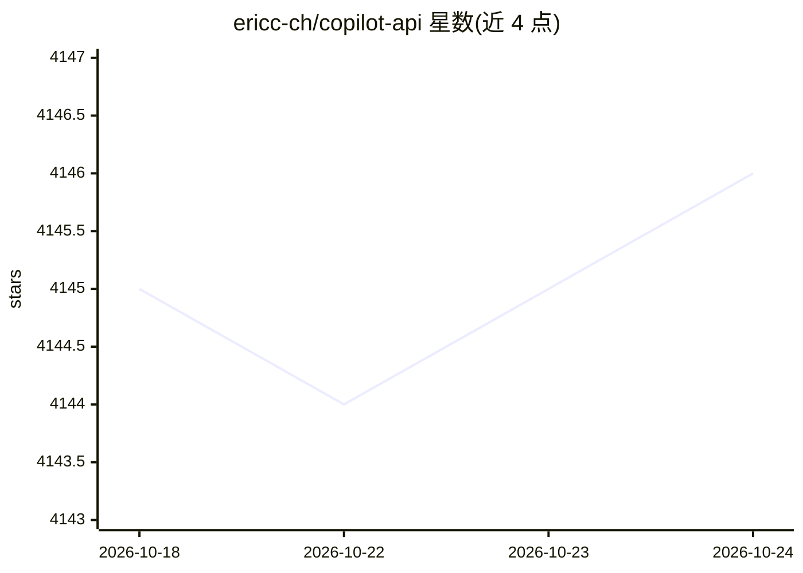

# ericc-ch/copilot-api

⭐ 4,146 · TypeScript · MIT · 推送 2025-11-10 · [GitHub](https://github.com/ericc-ch/copilot-api) · [官网](https://ericc-ch.github.io/copilot-api/?endpoint=http://localhost:4141/usage) · 个人维护

**把 GitHub Copilot 变成 OpenAI/Anthropic 兼容 API 的代理服务器**

对 GitHub Copilot API 的逆向代理，将其暴露为 OpenAI 兼容（/v1/chat/completions、/v1/models、/v1/embeddings）和 Anthropic 兼容（/v1/messages）端点，使支持这两类 API 的工具（包括 Claude Code）可以使用 Copilot 作为后端。支持个人/商业/企业版 Copilot 订阅，提供用量仪表盘、速率限制、手动请求审批、交互式或 token 直接认证。可通过 npx、Docker 或 Bun 从源码运行。README 声明为逆向工程、非 GitHub 官方支持，可能随时失效，且过量自动化使用可能触发 GitHub 滥用检测导致账号受限。

## 筛选速览

| 维度 | 判定 | 备注 |
|---|---|---|
| AI 角色 | `ai-ecosystem` | LLM/agent 周边工具 |
| 许可风险 | `permissive` | MIT |
| 部署形态 | `self-host` | docker 或自建部署 |
| 模型依赖 | locked-api |  |
| 硬件要求 | — | 无带数字的原话,不猜 |
| 安装摩擦 | `low` | 无编译、无系统依赖或容器化 |
| 成熟度 | — | 结构信号不足 |

## 能力要点

- 暴露 OpenAI 与 Anthropic 双兼容端点
- --claude-code 一条命令生成 Claude Code 启动配置
- Web 用量仪表盘展示配额与统计
- 速率限制（--rate-limit/--wait）与手动请求审批（--manual）

## 适用场景

- 让 Claude Code 或其他 OpenAI 兼容客户端用 Copilot 订阅作后端
- 监控 GitHub Copilot API 用量与配额
- CI/CD 环境下用 token 直接认证运行代理

## 场景标签

`模型网关` · 领域:Agent 开发

## 证据(README 行号)

> L26: A reverse-engineered proxy for the GitHub Copilot API that exposes it as an OpenAI and Anthropic compatible service
> L30: - **OpenAI & Anthropic Compatibility**: Exposes GitHub Copilot as an OpenAI-compatible (`/v1/chat/completions`, `/v

## 星数曲线

2026-10-18 4,145 → 2026-10-24 4,146（+1）

---
*卡片 v1 · prompt 1.4 · 生成 2026-10-20 · 置信度 high · 依据 README sha `435d6b708a4d` · [字段定义](../../DATASET.md)*
