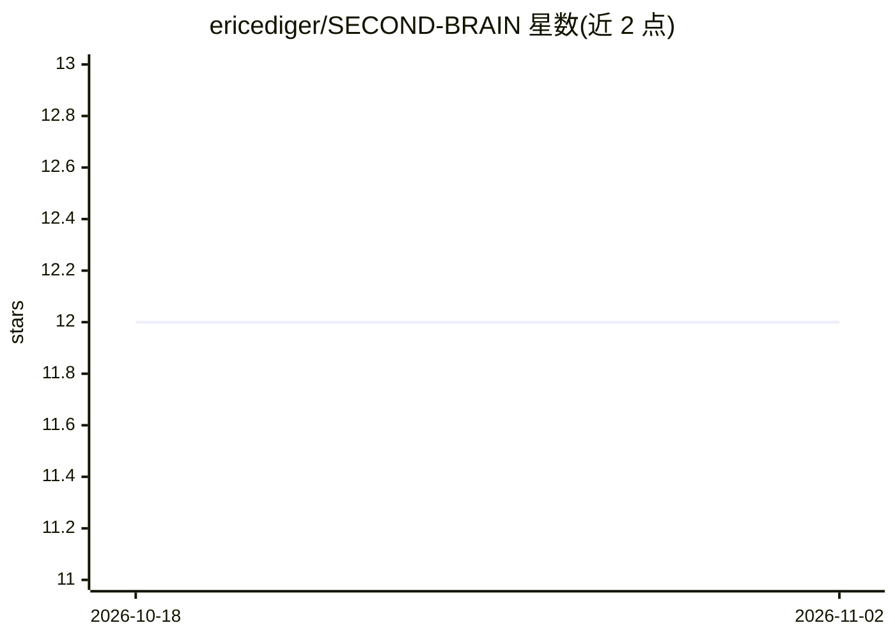

# ericediger/SECOND-BRAIN

⭐ 12 · Python · 推送 2026-01-13 · [GitHub](https://github.com/ericediger/SECOND-BRAIN) · 个人维护

**本地个人知识管理系统：AI 分类笔记、语音输入与自动回顾**

基于 Python/Flask 的本地个人知识管理实现：捕获文本或语音笔记，由 Claude 将其分类为 People、Projects、Ideas、Admin 四类，以 markdown 加 YAML frontmatter 形式存入 Obsidian 兼容 vault；Whisper 负责语音转录，支持自然语言查询 vault 并生成每日/每周摘要。前端为单个 HTML 文件，无构建步骤。运行需 Python 3.10+、Anthropic API key 与 OpenAI API key（Whisper），无 Docker 或桌面安装包，需从源码克隆运行。

## 筛选速览

| 维度 | 判定 | 备注 |
|---|---|---|
| AI 角色 | `ai-enhanced` | 去掉 AI 部分产品仍成立 |
| 许可风险 | `none` | — |
| 部署形态 | `library` | 以包/库形式分发 |
| 模型依赖 | locked-api |  |
| 硬件要求 | — | 无带数字的原话,不猜 |
| 安装摩擦 | `low` | 无编译、无系统依赖或容器化 |
| 成熟度 | — | 结构信号不足 |

## 能力要点

- AI 将笔记分类为 People/Projects/Ideas/Admin 四类
- Whisper 语音转录输入
- 存储为 Obsidian 兼容 vault（markdown + YAML frontmatter）
- 自然语言查询 vault 与每日/每周摘要生成

## 适用场景

- 我想把随手记的文本或语音笔记自动归类到 Obsidian 库
- 用自然语言查询自己的笔记库
- 每日/每周自动生成笔记摘要回顾

## 场景标签

`知识库管理` `语音识别` · 领域:知识与检索

## 证据(README 行号)

> L3: A local personal knowledge management system with AI classification, voice input, and automated resurfacing.
> L8: - **AI classifies** into People, Projects, Ideas, or Admin
> L18: - **AI:** Claude (classification/queries), Whisper (transcription)

## 星数曲线

2026-10-18 12 → 2026-11-02 12（+0）

---
*卡片 v1 · prompt 1.4 · 生成 2026-11-01 · 置信度 mid · 依据 README sha `74fd78e49457` · [字段定义](../../DATASET.md)*
