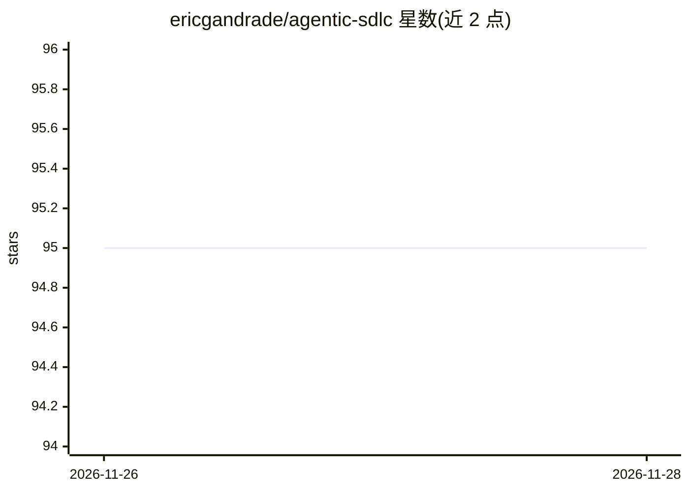

# ericgandrade/agentic-sdlc

⭐ 95 · JavaScript · MIT · 推送 2026-11-27 · [GitHub](https://github.com/ericgandrade/agentic-sdlc) · [官网](https://www.npmjs.com/package/agentic-sdlc-method) · 个人维护

**给已用AI编码工具的团队提供可审计的代理化软件开发流程方法**

一套厂商中立的 AI 原生软件交付方法：由 Scrum Master 协调 13 个专职 agent、23 个 Markdown 格式 skill，覆盖从想法到生产的 7 个生命周期阶段，并设置 4 个人工签核点。核心机制包括先写验收标准再写代码、每次"完成"声明附带命令输出与文件树指纹证据、独立评审者以全新上下文复核、数值循环限制防止 agent 打转。以两条命令开始使用，可在 Claude Code、GitHub Copilot CLI 等多种工具中运行。README 声明该方法尚未经人类团队试点。

## 筛选速览

| 维度 | 判定 | 备注 |
|---|---|---|
| AI 角色 | `ai-ecosystem` | LLM/agent 周边工具 |
| 许可风险 | `permissive` | MIT |
| 部署形态 | `library` | 以包/库形式分发 |
| 模型依赖 | — | README 未给出锁定关系 |
| 硬件要求 | — | 无带数字的原话,不猜 |
| 安装摩擦 | `low` | 无编译、无系统依赖或容器化 |
| 成熟度 | `idea` | |

## 能力要点

- 13 个专职 agent、23 个 skill、7 个阶段、4 个人工签核点
- 每项"完成"声明附带命令、退出码与被测文件树指纹证据
- 四种评审视角（规格/正确性与设计/安全/对抗性）在全新上下文运行
- 按变更规模与风险选择 Quick/Standard/Full 三条路径

## 适用场景

- 团队需要为 AI 生成的代码留下审计追踪
- 为每个阶段指定人员签核并绑定确切批准版本
- 防止 agent 在修复循环中无限打转

## 场景标签

`编码 Agent` `代码审查` `工作流自动化` · 领域:效率与自动化

## 证据(README 行号)

> L11:  The definitive approach to AI-native software engineering. Agent-driven, human-governed, evidence-verified. 13 spe
> L15: **It is for engineering teams that already use AI coding agents and need an audit trail:** who asked for what, what
> L33: |Skill, router, bundle|A skill is a Markdown workflow an AI tool loads; the router skill picks the right one; a bun

## 星数曲线

2026-11-26 95 → 2026-11-28 95（+0）

---
*卡片 v1 · prompt 1.4 · 生成 2026-11-26 · 置信度 high · 依据 README sha `17a9c725b519` · [字段定义](../../DATASET.md)*
