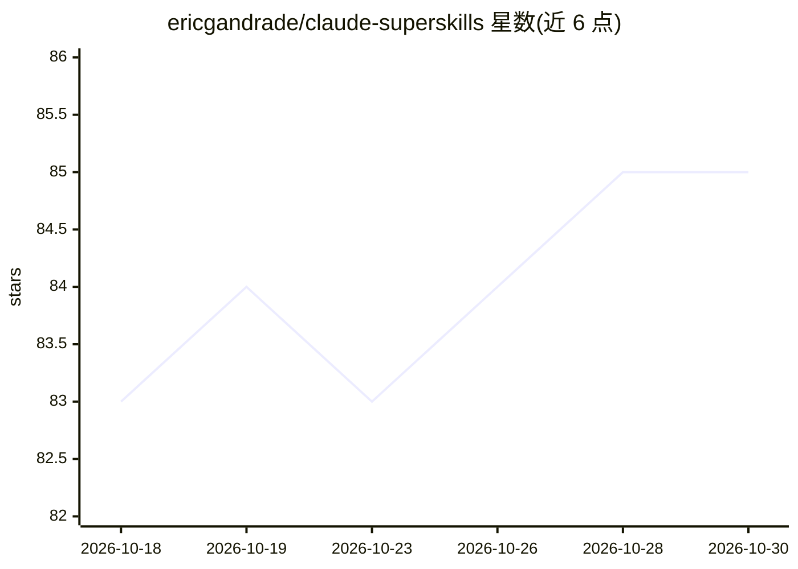

# ericgandrade/claude-superskills

⭐ 85 · JavaScript · MIT · 推送 2026-05-11 · [GitHub](https://github.com/ericgandrade/claude-superskills) · 个人维护

**跨 8 个 AI 编码助手的 18 个通用技能包平台**

以 SKILL.md 通用格式分发的 AI 技能集合与安装器：18 个技能覆盖编排规划（brainstorming、writing-plans、deep-research）、开发自动化（skill-creator、prompt-engineer）与内容处理（音频转写、PPT 翻译、文档转换）。安装器将技能复制到 GitHub Copilot、Claude Code、Codex、Gemini CLI、Cursor 等 8 个平台的技能目录，支持 npx 零安装、npm 全局、curl 脚本与本地 git clone 四种安装方式，另提供 Claude Code 原生插件通道。限制：需要 Node.js 14+ 和至少一个已安装的目标平台。

## 筛选速览

| 维度 | 判定 | 备注 |
|---|---|---|
| AI 角色 | `ai-ecosystem` | LLM/agent 周边工具 |
| 许可风险 | `permissive` | MIT |
| 部署形态 | `library` | 以包/库形式分发 |
| 模型依赖 | — | README 未给出锁定关系 |
| 硬件要求 | — | 无带数字的原话,不猜 |
| 安装摩擦 | `low` | 无编译、无系统依赖或容器化 |
| 成熟度 | — | 结构信号不足 |

## 能力要点

- 18 个技能按发现编排/开发自动化/规划执行/研究/内容处理分类
- 一份技能分发到 8 个平台（Claude Code、Copilot、Cursor、Gemini CLI 等）的统一安装器
- Claude Code 原生插件通道与 Cowork 手动 zip 上传通道
- 技能包（bundles）、关键字搜索与 doctor 安装诊断命令

## 适用场景

- 在多个 AI 编码助手上复用同一套规划与研究技能
- 为 Claude Code 安装技能后用斜杠命令调用
- 按需批量安装 essentials 等精选技能包

## 场景标签

 · 领域:开发者工具/AI 技能平台

## 证据(README 行号)

> L161: - **18 Universal Skills** - Work on all platforms
> L165: - **8 Platform Support** - GitHub Copilot, Claude Code, Codex, OpenCode, Gemini, Antigravity, Cursor, AdaL
> L267: These skills follow the universal `SKILL.md` format and work with any AI coding assistant that supports agentic sk

## 星数曲线

2026-10-18 83 → 2026-10-30 85（+2）

---
*卡片 v1 · prompt 1.4 · 生成 2026-10-24 · 置信度 high · 依据 README sha `380901a95bf4` · [字段定义](../../DATASET.md)*
