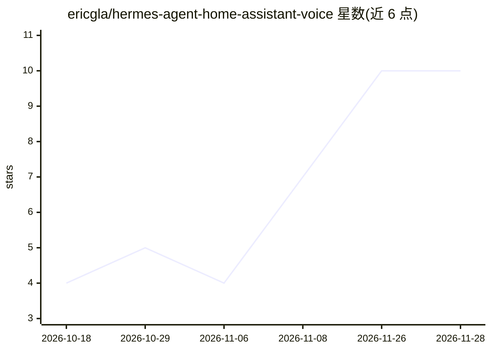

# ericgla/hermes-agent-home-assistant-voice

⭐ 10 · Python · MIT · 推送 2026-10-14 · [GitHub](https://github.com/ericgla/hermes-agent-home-assistant-voice) · 个人维护

**把 Hermes Agent 接入 Home Assistant 语音设备的自定义集成**

Home Assistant 的 HACS 自定义集成，将用户自己的 Hermes Agent 注册为 Assist 对话代理：语音卫星设备（如 Voice PE）的转写文本经 API server 发往 Hermes 网关（POST /v1/responses），回答以 1-3 句口语化短句播回，支持上下文跟进、房间/音乐上下文注入、长时间请求的 hand-off 播报、自动化中通过 hermes_conversation.ask 动作调用，以及网关健康传感器。要求 Home Assistant 2025.8+ 与已开启 API server 的 Hermes 网关；唤醒词、STT、TTS 仍由 Home Assistant 原有流程处理，本集成不运行 Hermes 本体。

## 筛选速览

| 维度 | 判定 | 备注 |
|---|---|---|
| AI 角色 | `ai-ecosystem` | LLM/agent 周边工具 |
| 许可风险 | `permissive` | MIT |
| 部署形态 | `library` | 以包/库形式分发 |
| 模型依赖 | — | README 未给出锁定关系 |
| 硬件要求 | — | 无带数字的原话,不猜 |
| 安装摩擦 | `low` | 无编译、无系统依赖或容器化 |
| 成熟度 | — | 结构信号不足 |

## 能力要点

- 将 Hermes 注册为 Assist 对话代理，语音请求直达已有 agent（工具/技能/记忆/账号）
- 每轮注入设备与房间位置上下文，媒体播放器随房间路由
- 长请求 hand-off：超时播报 "I'm working on that"，完成后在同一设备读出答案
- 自动化动作 hermes_conversation.ask 与网关健康状态传感器

## 适用场景

- 用 Voice PE 等语音卫星和家里的 Hermes Agent 对话，如查邮件、加购物车
- 让 Hermes 同时控制 Home Assistant 设备（关灯、切歌）
- 在自动化流程中调用 Hermes 获取完整回答（如早晨简报推送）

## 场景标签

`语音 Agent` · 领域:对话与助手

## 证据(README 行号)

> L3: This integration lets you talk to your own Hermes Agent
> L45: The integration registers Hermes as an Assist conversation agent. Your satellite still uses
> L52:                       ├─ Conversation agent: Hermes ──POST /v1/responses──▶ Hermes gateway

## 星数曲线

2026-10-18 4 → 2026-11-28 10（+6）

---
*卡片 v1 · prompt 1.4 · 生成 2026-11-26 · 置信度 mid · 依据 README sha `33053d17079b` · [字段定义](../../DATASET.md)*
