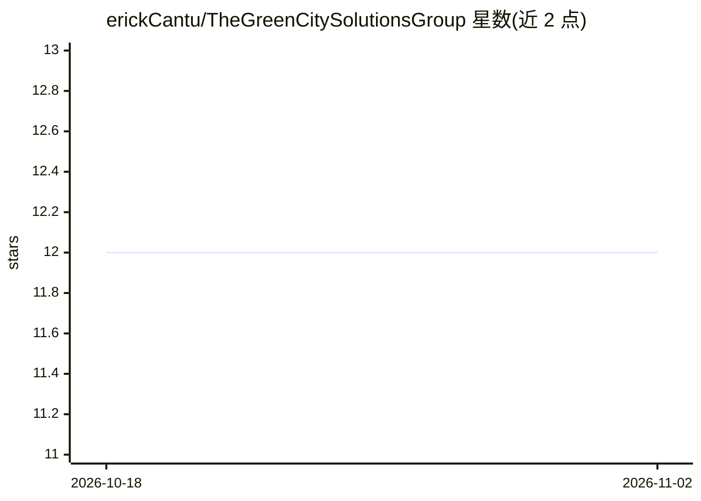

# erickCantu/TheGreenCitySolutionsGroup

⭐ 12 · Jupyter Notebook · MIT · 推送 2026-05-19 · [GitHub](https://github.com/erickCantu/TheGreenCitySolutionsGroup) · 组织维护

**建筑能耗预测的时间序列分析课程项目（9 栋建筑）**

Neuefische 数据科学训练营的结业项目：基于 CityLearn Challenge 的 9 栋建筑 4 年小时级能耗与气象数据，进行趋势与季节性分析，比较基线、线性/多项式回归、SARIMAX、Prophet、TBats、XGBoost、Random Forest 等模型对净能耗 24 小时预测的表现，结果显示树模型（Random Forest、XGBoost）的 MAE 最低。结果通过 MLFlow 跟踪，并提供 Dash 仪表盘对比测试年任意日期的预测。需 Python 3.9.8 环境与本地 MLFlow URI 文件运行。

## 筛选速览

| 维度 | 判定 | 备注 |
|---|---|---|
| AI 角色 | `ai-native` | 本体是模型或模型工具 |
| 许可风险 | `permissive` | MIT |
| 部署形态 | `library` | 以包/库形式分发 |
| 模型依赖 | — | README 未给出锁定关系 |
| 硬件要求 | — | 无带数字的原话,不猜 |
| 安装摩擦 | `low` | 无编译、无系统依赖或容器化 |
| 成熟度 | — | 结构信号不足 |

## 能力要点

- 对比 8 类时间序列与机器学习模型（SARIMAX/Prophet/TBats/XGBoost/Random Forest 等）
- 以 MAE 为指标，树模型（Random Forest、XGBoost）误差最低
- MLFlow 跟踪模型指标（MAE、MSE、R2）
- Dash 仪表盘展示并对比测试年任意日期的预测结果

## 适用场景

- 查看建筑群小时级能耗的 24 小时预测建模流程
- 对比时间序列模型与机器学习模型在能耗预测上的表现
- 参考 Jupyter notebook 组织的 EDA 与建模项目结构

## 场景标签

 · 领域:能源/数据科学

## 证据(README 行号)

> L56: Different models were applied and compared:
> L86: The tree-based machine learning models (Random forest and XGBoost) produced forecasts with the lowest mean absolute

## 星数曲线

2026-10-18 12 → 2026-11-02 12（+0）

---
*卡片 v1 · prompt 1.4 · 生成 2026-11-01 · 置信度 high · 依据 README sha `7df01474d152` · [字段定义](../../DATASET.md)*
