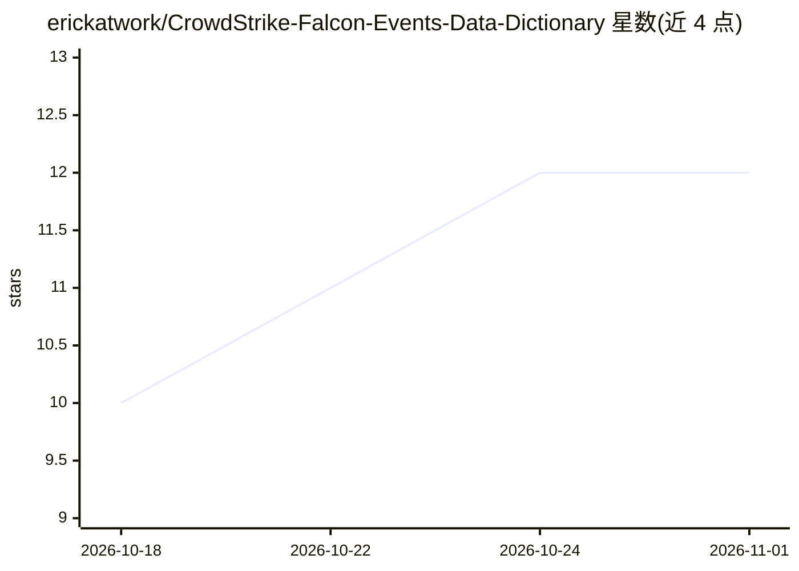

# erickatwork/CrowdStrike-Falcon-Events-Data-Dictionary

⭐ 12 · Python · Apache-2.0 · 推送 2026-06-03 · [GitHub](https://github.com/erickatwork/CrowdStrike-Falcon-Events-Data-Dictionary) · [官网](https://docs.crowdstrike.com/r/en-US/sensormap.ftmap) · 个人维护

**Falcon 传感器事件数据字典：CSV/Markdown 机器可读版（998 事件）**

将官方 CrowdStrike Falcon 传感器事件数据字典 PDF（1,500+ 页、需认证访问）转写为版本化的纯文本 CSV 与 Markdown 数据，覆盖 998 个事件及 Windows/Linux/macOS/iOS/Android 等平台。数据可直接载入 SIEM 或 LLM 上下文，提供稳定原始 URL、pandas 快速加载示例、Claude Skill 与即贴系统提示词；附 Python 提取脚本（uv 运行）支持从新 PDF 再生成并对目录校验。社区维护、非官方，事件定义版权仍属 CrowdStrike。

## 筛选速览

| 维度 | 判定 | 备注 |
|---|---|---|
| AI 角色 | `ai-knowledge` | 知识聚合/清单类 |
| 许可风险 | `permissive` | Apache-2.0 |
| 部署形态 | `None` |  |
| 模型依赖 | — | README 未给出锁定关系 |
| 硬件要求 | — | 无带数字的原话,不猜 |
| 安装摩擦 | `low` | 无编译、无系统依赖或容器化 |
| 成熟度 | — | 结构信号不足 |

## 能力要点

- 官方 PDF 转写为 CSV/Markdown 纯文本，按 ISO 日期快照版本化，可 diff 跨版本变化
- 数据约 300KB，可整体放入单个 LLM 上下文，提供稳定原始 URL
- 附 Claude Skill 与通用系统提示词供 AI 流水线使用
- 提取脚本以目录为白名单校验，自动刷新 data/current 与 README 徽章

## 适用场景

- 威胁狩猎与检测工程中查询 Falcon 事件含义
- SIEM 接入时核对 Falcon 事件 schema
- 把事件字典喂给 LLM/RAG 做 SOC 问答助手

## 场景标签

`网络安全` · 领域:学习与行业

## 证据(README 行号)

> L14: The official CrowdStrike Falcon **Events Data Dictionary** is enormous (1,500+ pages) and lives behind authenticati
> L22: ## 🤖 Use it with AI / LLMs (RAG, agents, chatbots)

## 星数曲线

2026-10-18 10 → 2026-11-01 12（+2）

---
*卡片 v1 · prompt 1.4 · 生成 2026-11-01 · 置信度 high · 依据 README sha `8b9837cb2b2c` · [字段定义](../../DATASET.md)*
