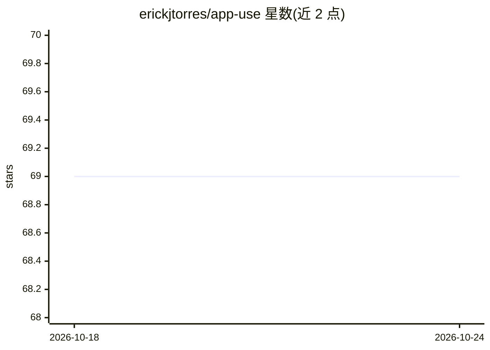

# erickjtorres/app-use

⭐ 69 · Python · MIT · 推送 2026-10-23 · [GitHub](https://github.com/erickjtorres/app-use) · 个人维护

**让 AI agent 通过 Appium 控制移动应用的 Python 框架**

App Use 是一个 Python 库，用于连接 AI agent 与 iOS/Android 移动应用：通过 Appium 服务器指定目标设备与 bundle id，创建可执行应用内操作的 agent。安装提供 pip 基础包、memory 扩展（因 Pytorch 兼容性要求 Python<3.13）与 cli 扩展（用于安装驱动等依赖）三种形式，基础安装要求 Python>=3.11。使用时需在 .env 中配置模型提供商（OpenAI/Anthropic/Azure 等）的 API key。README 展示了 iOS 上在 Lululemon 与 DoorDash 应用下单的演示。

## 筛选速览

| 维度 | 判定 | 备注 |
|---|---|---|
| AI 角色 | `ai-ecosystem` | LLM/agent 周边工具 |
| 许可风险 | `permissive` | MIT |
| 部署形态 | `library` | 以包/库形式分发 |
| 模型依赖 | — | README 未给出锁定关系 |
| 硬件要求 | — | 无带数字的原话,不猜 |
| 安装摩擦 | `low` | 无编译、无系统依赖或容器化 |
| 成熟度 | — | 结构信号不足 |

## 能力要点

- 基于 Appium 的 iOS/Android 应用自动化 agent 接口
- 提供 memory 与 cli 两个 pip 扩展安装选项
- 支持 OpenAI/Anthropic/Azure 等模型提供商（通过 .env 配置 API key）
- 附 iOS 应用下单操作演示（Lululemon、DoorDash）

## 适用场景

- 构建能在手机应用内执行操作的 AI agent
- 自动化 iOS/Android 应用的端到端任务流程
- 为现有 agent 项目添加移动端应用控制能力

## 场景标签

`GUI 自动化` `Agent 框架` · 领域:Agent 开发

## 证据(README 行号)

> L10: 📱 App Use is the easiest way to connect AI agents with mobile applications.
> L41:     app = App(

## 星数曲线

2026-10-18 69 → 2026-10-24 69（+0）

---
*卡片 v1 · prompt 1.4 · 生成 2026-10-24 · 置信度 high · 依据 README sha `38e4228f1e21` · [字段定义](../../DATASET.md)*
