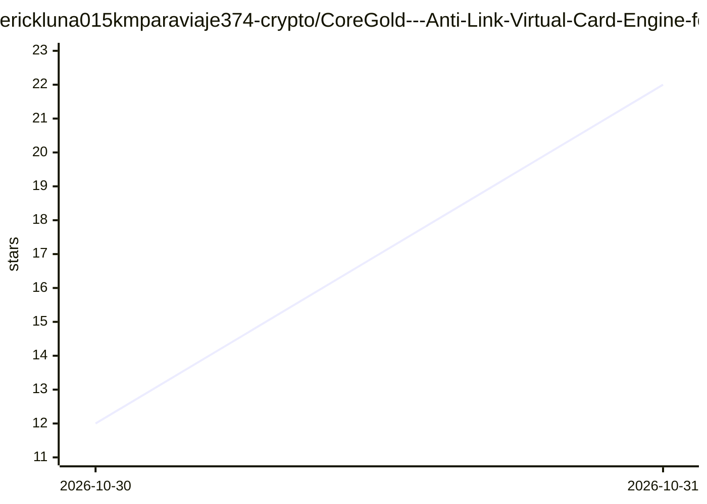

# erickluna015kmparaviaje374-crypto/CoreGold---Anti-Link-Virtual-Card-Engine-for-Bulk-Account-Scaling

⭐ 22 · 推送 2026-10-28 · [GitHub](https://github.com/erickluna015kmparaviaje374-crypto/CoreGold---Anti-Link-Virtual-Card-Engine-for-Bulk-Account-Scaling) · [官网](https://app.coregold.io/signup?invite_code=ADvlj9b) · 组织维护 · 中文 README

**面向多账号矩阵团队的虚拟卡发卡平台（非软件仓库）**

README 为商业虚拟卡服务的推广页面，无代码内容：宣称提供批量开卡、一号一卡独立卡号、独立账单地址、单卡消费限额、USDT 充值自动结算为美元额度、销卡后余额回拨母账户等功能，面向社媒投放多号矩阵、电商多店铺站群、海外账号批量注册等团队。使用流程为注册控制台、USDT 划转、后台批量取卡，属在线服务，不提供本地安装或运行方式。

## 筛选速览

| 维度 | 判定 | 备注 |
|---|---|---|
| AI 角色 | `ai-enhanced` | 去掉 AI 部分产品仍成立 |
| 许可风险 | `none` | — |
| 部署形态 | `None` |  |
| 模型依赖 | — | README 未给出锁定关系 |
| 硬件要求 | — | 无带数字的原话,不猜 |
| 安装摩擦 | `low` | 无编译、无系统依赖或容器化 |
| 成熟度 | — | 结构信号不足 |

## 能力要点

- 批量生成独立卡号/CVV/到期时间的虚拟卡
- USDT 链上充值自动结算为美元额度
- 单卡预算限额与销卡后余额回拨
- 全流程经官方控制台在线操作

## 适用场景

- 多广告投放账号各自绑定独立虚拟卡
- 多店铺站群分账扣费隔离
- 批量测试账号小额验资后快速销卡

## 场景标签

 · 领域:跨境支付/虚拟卡服务

## 证据(README 行号)

> L33: |**AI 算力与开发账号组**|`多 OpenAI API 账号`, `Claude Pro 矩阵`, `Cursor Pro`|突破单人单卡绑定制约，方便技术团队按项目、按微服务分拆成本|

## 星数曲线

2026-10-30 12 → 2026-10-31 22（+10）

---
*卡片 v1 · prompt 1.4 · 生成 2026-10-30 · 置信度 low · 依据 README sha `8d7d2f6cbb59` · [字段定义](../../DATASET.md)*
