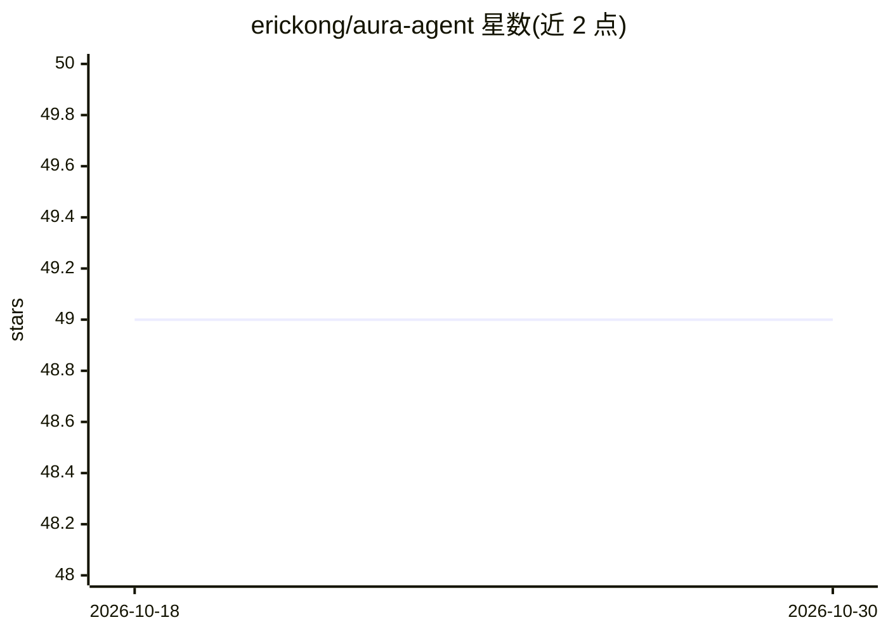

# erickong/aura-agent

⭐ 49 · Python · 推送 2026-05-25 · [GitHub](https://github.com/erickong/aura-agent) · 个人维护

**面向长时任务的自主任务编排器，Docker 隔离执行子任务**

Aura 是一个自主任务编排器：将 Markdown 目标分解为子任务树，按难度路由到 Pro 或 Flash 两级 worker（后端可为 Claude Code、Qwen Code、Codex CLI、ds_code、OpenCode 等），依据验收标准持续核验产出，可连续运行数小时或数天。支持可选的 Docker 隔离执行（独立容器、非 root、CPU/内存/GPU 资源限制），运行中可编辑 task.md 触发自动重规划。通过 git clone 加 pip 可编辑安装，含 Rich 终端仪表盘与决策日志。

## 筛选速览

| 维度 | 判定 | 备注 |
|---|---|---|
| AI 角色 | `ai-ecosystem` | LLM/agent 周边工具 |
| 许可风险 | `none` | — |
| 部署形态 | `self-host` | docker 或自建部署 |
| 模型依赖 | — | README 未给出锁定关系 |
| 硬件要求 | — | 无带数字的原话,不猜 |
| 安装摩擦 | `low` | 无编译、无系统依赖或容器化 |
| 成熟度 | — | 结构信号不足 |

## 能力要点

- 目标驱动的任务分解与 Pro/Flash 双层 worker 路由（4 种委派模式）
- 可选 Docker 隔离：独立容器、非 root 用户、资源限制、GHCR 预构建镜像
- 运行中编辑 task.md 可触发检测、重规划并继续工作
- 支持 Claude Code / Qwen Code / Codex CLI / ds_code / OpenCode 多种 worker 后端

## 适用场景

- 把量化交易流水线等长周期项目交给 agent 自主完成
- 生成研究报告、白皮书或文档
- 最少监督下自动化重复编码与数据处理任务

## 场景标签

`Agent 框架` `编码 Agent` · 领域:Agent 开发

## 证据(README 行号)

> L5: **Aura** is an autonomous task orchestrator designed for ambitious, long-running projects that demand deep multi-fac
> L149: |**System level**|Inside Codex|Above coding agents|Inside GitHub|General assistant|

## 星数曲线

2026-10-18 49 → 2026-10-30 49（+0）

---
*卡片 v1 · prompt 1.4 · 生成 2026-10-24 · 置信度 mid · 依据 README sha `aba841ce89e1` · [字段定义](../../DATASET.md)*
