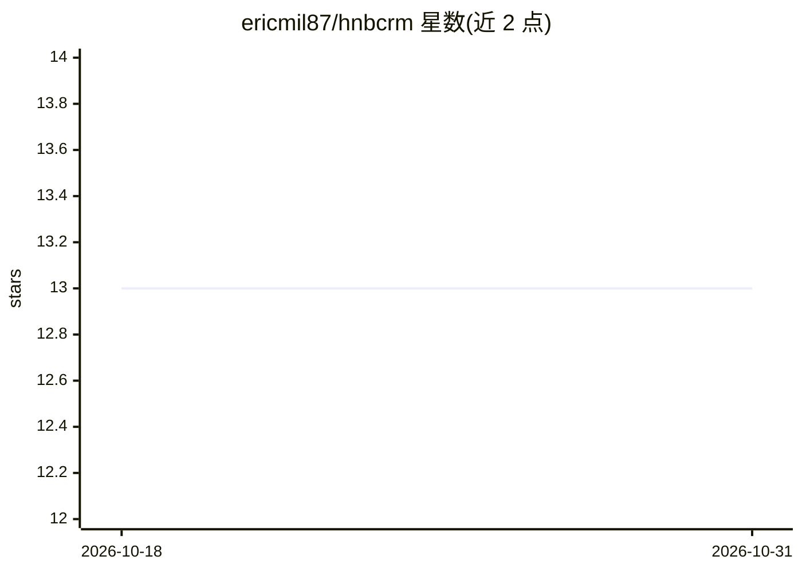

# ericmil87/hnbcrm

⭐ 13 · TypeScript · MIT · 推送 2026-10-23 · [GitHub](https://github.com/ericmil87/hnbcrm) · [官网](https://hnbcrm.com) · 个人维护

**人机共用 CRM：人类与 AI 机器人同管道协作管客户**

多租户 CRM，面向同时使用人类坐席与 AI 机器人的销售/客服团队：线索、会话与交接在共享管道、统一收件箱与实时协作工具中流转。AI 能力包括应用内 Copilot（以登录用户 RBAC 读写 CRM，两阶段确认）、WhatsApp AI 草拟回复（默认建议模式）、自托管 Whisper 语音转写。另提供 REST API、68 工具 MCP 服务器与 Agent Skills 包。技术栈为 React 19 + Convex，git clone 源码 + npm 运行，需 Node.js 18+。

## 筛选速览

| 维度 | 判定 | 备注 |
|---|---|---|
| AI 角色 | `ai-enhanced` | 去掉 AI 部分产品仍成立 |
| 许可风险 | `permissive` | MIT |
| 部署形态 | `library` | 以包/库形式分发 |
| 模型依赖 | — | README 未给出锁定关系 |
| 硬件要求 | — | 无带数字的原话,不猜 |
| 安装摩擦 | `low` | 无编译、无系统依赖或容器化 |
| 成熟度 | — | 结构信号不足 |

## 能力要点

- 人类与 AI 机器人为平等参与者，共享上下文与管道
- AI Copilot 以登录用户 RBAC 操作 CRM，破坏性操作两阶段确认
- MCP 服务器提供 68 个工具供 AI agent 接入
- 自托管 Whisper 本地转写语音，无需付费 API

## 适用场景

- 销售/客服团队让 AI 机器人与人工坐席在统一收件箱协作处理线索
- 通过 WhatsApp 渠道用 AI 草拟回复并由人工审核
- 让外部 AI agent 通过 MCP 或 REST API 读写 CRM 数据

## 场景标签

`语音识别` `AI 助手` · 领域:对话与助手

## 证据(README 行号)

> L13: HNBCRM (Humans & Bots CRM) is a multi-tenant CRM built for teams that combine human agents and AI bots. Leads, conv
> L17: - **AI-Human Collaboration** — Human team members and AI bots are equal participants with shared context
> L18: - **AI Copilot** — In-app assistant (opt-in per org) that reads and edits the CRM as the logged-in user (their RBAC

## 星数曲线

2026-10-18 13 → 2026-10-31 13（+0）

---
*卡片 v1 · prompt 1.4 · 生成 2026-10-31 · 置信度 high · 依据 README sha `d7647fc53d20` · [字段定义](../../DATASET.md)*
