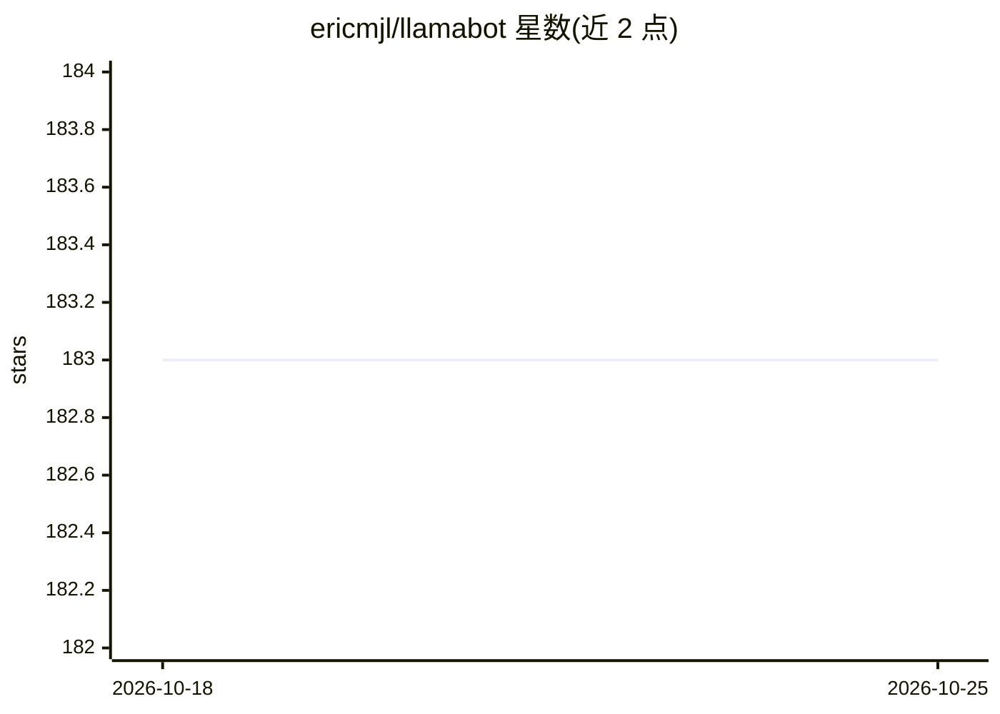

# ericmjl/llamabot

⭐ 183 · Python · 推送 2026-10-23 · [GitHub](https://github.com/ericmjl/llamabot) · [官网](https://ericmjl.github.io/llamabot/) · 个人维护

**Python 类式 LLM 接口库：在代码/Jupyter 中便捷调用各类模型**

以 Pythonic 类接口封装 LLM 调用的库：通过 LiteLLM 支持所有 LiteLLM 兼容模型，接入方式包括 OpenAI/Mistral 等 API 提供商及本地 Ollama、LMStudio。提供 SimpleBot（无状态调用，可加 ChatMemory）、ToolBot（单轮工具/函数调用）、QueryBot（文档库检索问答）、StructuredBot（Pydantic 校验与重试的结构化输出）、ImageBot（图像生成）与图像输入支持，另带 CLI 示例与本地实验记录机制。面向在 Jupyter 与 Python 应用中实验和构建 LLM 功能的开发者。

## 筛选速览

| 维度 | 判定 | 备注 |
|---|---|---|
| AI 角色 | `ai-ecosystem` | LLM/agent 周边工具 |
| 许可风险 | `none` | — |
| 部署形态 | `library` | 以包/库形式分发 |
| 模型依赖 | local-ok | 支持本地模型 |
| 硬件要求 | — | 无带数字的原话,不猜 |
| 安装摩擦 | `low` | 无编译、无系统依赖或容器化 |
| 成熟度 | — | 结构信号不足 |

## 能力要点

- SimpleBot/ToolBot/QueryBot/StructuredBot/ImageBot 五类 Bot 接口
- 支持 LiteLLM 全部兼容模型：API 提供商与本地 Ollama/LMStudio
- StructuredBot 提供 Pydantic 校验与自动重试
- Experiment 上下文管理器本地记录提示词实验

## 适用场景

- 在 Jupyter 中快速实验 prompt 与不同模型
- 从非结构化文本抽取符合 schema 的结构化数据
- 基于本地文档库做检索问答
- 构建自动写 commit message 等工具调用型脚本

## 场景标签

`提示工程` `RAG` · 领域:Agent 开发

## 证据(README 行号)

> L3: LlamaBot implements a Pythonic interface to LLMs,
> L6: All models supported by LiteLLM are supported by LlamaBot.

## 星数曲线

2026-10-18 183 → 2026-10-25 183（+0）

---
*卡片 v1 · prompt 1.4 · 生成 2026-10-23 · 置信度 high · 依据 README sha `c06f983e6d0f` · [字段定义](../../DATASET.md)*
