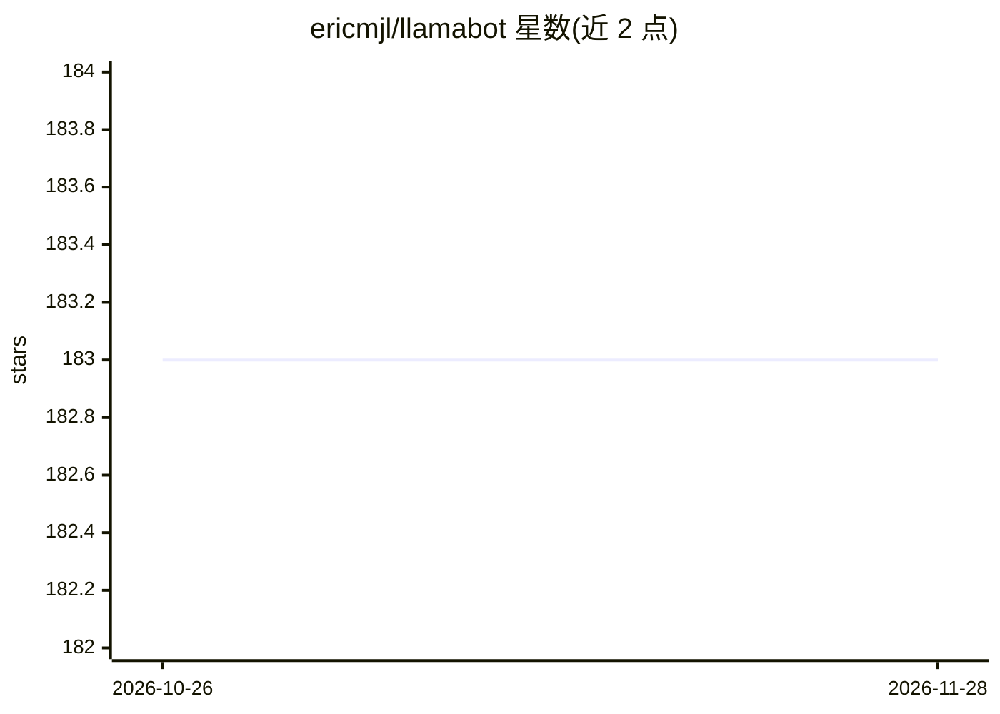

# ericmjl/llamabot

⭐ 183 · Python · 推送 2026-11-22 · [GitHub](https://github.com/ericmjl/llamabot) · [官网](https://ericmjl.github.io/llamabot/) · 个人维护

**面向 Python 开发者的 LLM 调用封装库**

LlamaBot 提供 Python 风格的类接口来调用 LLM，面向在 Jupyter notebook 中实验 LLM 或构建 Python 应用的开发者。通过 LiteLLM 接入多种模型，包含多个类：SimpleBot（无状态提示调用，可带 ChatMemory 对话记忆）、ToolBot（单轮函数调用）、QueryBot（配合 docstore 做文档检索问答）、StructuredBot（Pydantic 模式校验与自动重试）、ImageBot（图像生成），并支持 prompt 实验的本地记录与 CLI。

## 筛选速览

| 维度 | 判定 | 备注 |
|---|---|---|
| AI 角色 | `ai-ecosystem` | LLM/agent 周边工具 |
| 许可风险 | `none` | — |
| 部署形态 | `library` | 以包/库形式分发 |
| 模型依赖 | local-ok | 支持本地模型 |
| 硬件要求 | — | 无带数字的原话,不猜 |
| 安装摩擦 | `low` | 无编译、无系统依赖或容器化 |
| 成熟度 | `idea` | |

## 能力要点

- 基于 LiteLLM，支持其兼容的全部模型
- 五类 Bot 接口：SimpleBot/ToolBot/QueryBot/StructuredBot/ImageBot
- ChatMemory 支持线性记忆与基于图的对话线程记忆
- StructuredBot 提供 Pydantic 校验与自动重试

## 适用场景

- 在 Jupyter notebook 里做 prompt 实验
- 给 Python 应用加上聊天或文档问答功能
- 从非结构化文本提取符合模式的结构化输出
- 自动生成 git commit message 等 CLI 任务

## 场景标签

`模型网关` `RAG` `图像生成` · 领域:Agent 开发

## 证据(README 行号)

> L3: LlamaBot implements a Pythonic interface to LLMs,
> L5: and build Python apps that utilize LLMs.
> L6: All models supported by LiteLLM are supported by LlamaBot.

## 星数曲线

2026-10-26 183 → 2026-11-28 183（+0）

---
*卡片 v1 · prompt 1.4 · 生成 2026-11-26 · 置信度 high · 依据 README sha `79ed29bcca32` · [字段定义](../../DATASET.md)*
