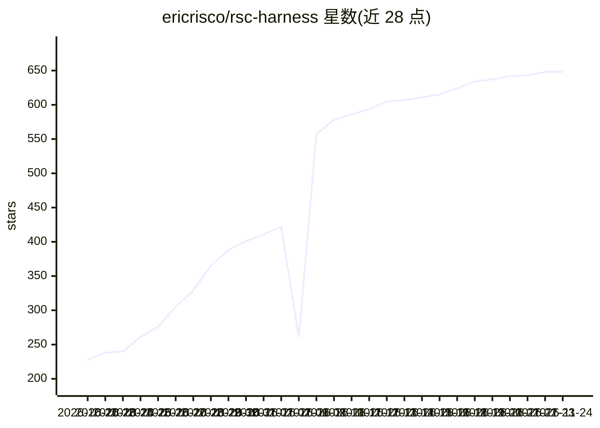

# ericrisco/rsc-harness

⭐ 656 · JavaScript · MIT · 推送 2026-11-23 · [GitHub](https://github.com/ericrisco/rsc-harness) · [官网](https://ericrisco.github.io/rsc-harness/) · 个人维护

**为 AI 编码助手配置项目级 harness：知识库、技能与规则**

通过 npx 引导式 CLI 为已有 AI 编码助手（Claude Code、Codex 等 19 个目标）生成项目级配置：读取项目证据后给出可审查的安装计划，写入 02-DOCS/ 项目知识 wiki、01-TOOLS/ 工具连接约定、从 273 个技能目录中按需选取的技能，以及工作规则与 provider 特定 hooks。三车道机制（只读回答/FTD/ASDD）由 agent 按任务声明；hooks 强制执行仅限 Claude Code，其他助手以技能与记忆形式承载。

## 筛选速览

| 维度 | 判定 | 备注 |
|---|---|---|
| AI 角色 | `ai-ecosystem` | LLM/agent 周边工具 |
| 许可风险 | `permissive` | MIT |
| 部署形态 | `self-host` | docker 或自建部署 |
| 模型依赖 | — | README 未给出锁定关系 |
| 硬件要求 | — | 无带数字的原话,不猜 |
| 安装摩擦 | `low` | 无编译、无系统依赖或容器化 |
| 成熟度 | — | 结构信号不足 |

## 能力要点

- 安装前生成可审查计划（selected/deferred/excluded）并输出 SHA-256 计划 ID
- 02-DOCS/ wiki 与 01-TOOLS/ 工具连接约定，支持 Obsidian vault 与 Open Knowledge Format
- 273 个技能按 manifest.json 目录推荐，渐进加载，多助手共享符号链接
- 三车道任务机制（Answer/FTD/ASDD）与 Claude Code hooks 守卫

## 适用场景

- 让多个 AI 编码助手共享同一份项目知识与规则
- 新会话不再重复交代技术栈与历史决策
- 在团队协作中约束 agent 在 main 分支上的提交行为

## 场景标签

`知识库管理` · 领域:知识与检索

## 证据(README 行号)

> L42: rsc-harness makes that choice explicit. It reads evidence within your project root, asks about your goal
> L68: |**Skills**|A selection from 273 available skills, loaded progressively when relevant.|
> L91: You keep your editor, model and existing project. rsc supplies the harness around them. Provider

## 星数曲线

2026-10-21 228 → 2026-11-24 648（+420）

---
*卡片 v1 · prompt 1.4 · 生成 2026-11-24 · 置信度 mid · 依据 README sha `4a3ab023eb74` · [字段定义](../../DATASET.md)*
