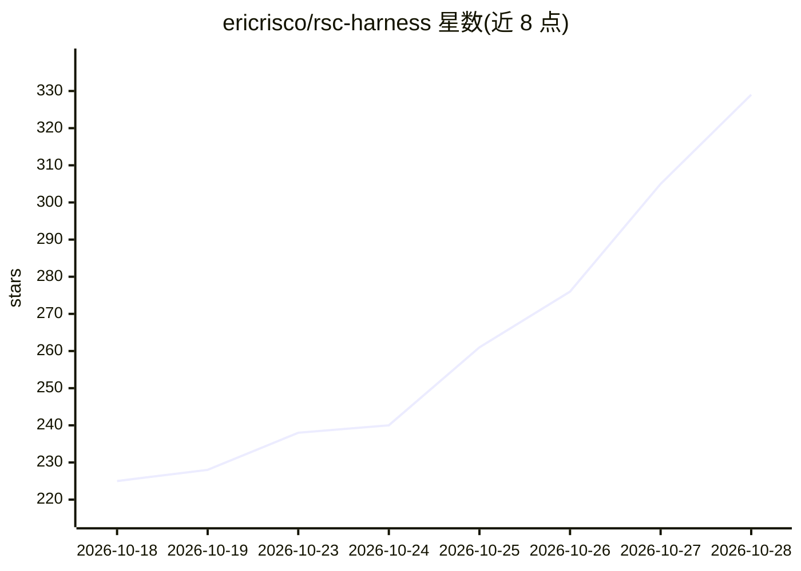

# ericrisco/rsc-harness

⭐ 329 · JavaScript · MIT · 推送 2026-10-27 · [GitHub](https://github.com/ericrisco/rsc-harness) · [官网](https://ericrisco.github.io/rsc-harness/) · 个人维护

**为 AI 编码助手装配记忆/工具/技能/hook 的元 harness**

面向使用 Claude Code、Codex、Cursor 等 18 种编码助手的开发者的元 harness 安装器：通过 npx onboard 以问答方式生成经验证的装配计划（选择/推迟/排除记忆、工具、技能与 hook），写入项目内的 02-DOCS/ 知识库、01-TOOLS/ 工具目录与 .rsc/skills/ 共享技能目录（272 个可按需安装）。机制上含三通道分流（Answer/FTD/SDD 十阶段链）、进度式技能加载、Claude Code 中的 hook 守卫（限其他助手无 hook 强制）。所有内容留在项目内，多助手共享一套符号链接。

## 筛选速览

| 维度 | 判定 | 备注 |
|---|---|---|
| AI 角色 | `ai-ecosystem` | LLM/agent 周边工具 |
| 许可风险 | `permissive` | MIT |
| 部署形态 | `self-host` | docker 或自建部署 |
| 模型依赖 | — | README 未给出锁定关系 |
| 硬件要求 | — | 无带数字的原话,不猜 |
| 安装摩擦 | `low` | 无编译、无系统依赖或容器化 |
| 成熟度 | — | 结构信号不足 |

## 能力要点

- npx onboard 生成经用户确认的装配计划（SHA-256 plan id）后才写入
- 18 种编码助手共享一份安装（.rsc/skills/ 符号链接，避免重复）
- Answer/FTD/SDD 三通道由 agent 按请求复杂度自选
- 技能库含 272 个技能，按项目证据逐个推荐安装

## 适用场景

- 为我的 AI 编码助手建立项目记忆，避免每次会话重复解释
- 多成员、多助手协作同一仓库时共享知识与工作区隔离
- 为 agent 接入业务工具并验证连接（含只读连接验证写入失败）

## 场景标签

`Agent 记忆` · 领域:Agent 开发

## 证据(README 行号)

> L13: Every time you open a project, your agent starts from zero. rsc is a meta-harness: it gives the
> L14: assistant you already use (Claude Code, Codex, Cursor and 15 more) a memory, hands, a trade and
> L100: - **Any assistant, or several at once.** 18 are supported, and they share one installation.

## 星数曲线

2026-10-18 225 → 2026-10-28 329（+104）

---
*卡片 v1 · prompt 1.4 · 生成 2026-10-22 · 置信度 mid · 依据 README sha `cd1854659f78` · [字段定义](../../DATASET.md)*
