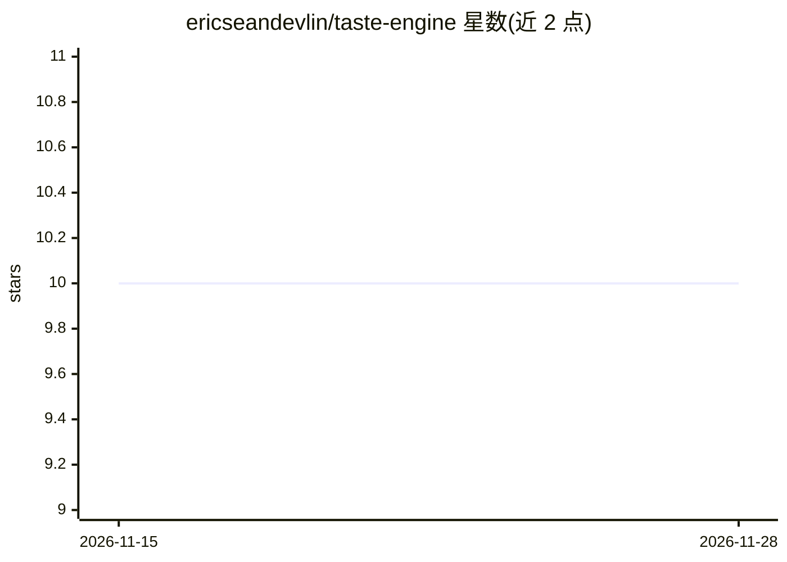

# ericseandevlin/taste-engine

⭐ 10 · JavaScript · MIT · 推送 2026-11-21 · [GitHub](https://github.com/ericseandevlin/taste-engine) · [官网](https://ericdevlin.co) · 个人维护

**从参考图板学习创作品味并生成自检海报的本地工具**

读取一个参考图像文件夹，提取可编辑的 Do/Don't 规则清单（带溯源），按规则生成海报并自检修复，规则存于可读可改的 JSON。流程包括测量、视觉模型标注、聚类、方向命名、规则合成与海报生成，结果页展示每条规则的 PASS/FAIL。面向设计师与创意开发者。需 Node 20+ 与 Gemini 或 OpenRouter 密钥，本地运行，规则可锁定、改写或拒绝后继续出图。

## 筛选速览

| 维度 | 判定 | 备注 |
|---|---|---|
| AI 角色 | `ai-native` | 本体是模型或模型工具 |
| 许可风险 | `permissive` | MIT |
| 部署形态 | `library` | 以包/库形式分发 |
| 模型依赖 | locked-api |  |
| 硬件要求 | — | 无带数字的原话,不猜 |
| 安装摩擦 | `low` | 无编译、无系统依赖或容器化 |
| 成熟度 | — | 结构信号不足 |

## 能力要点

- 从参考图板生成可编辑、可溯源的 Do/Don't 规则清单
- 海报生成后按规则自检并命名违规项进行修复重绘
- 规则存于 JSON，可改写/锁定/拒绝并保留至后续运行
- 本地运行，支持 Gemini 直连或经 OpenRouter 同模型调用

## 适用场景

- 从一组风格统一的海报参考中提炼设计规则并批量产出海报
- 编辑规则清单后重新生成符合自己品味的作品
- 活动海报按固定视觉方向快速生成多版并核验合规

## 场景标签

`图像生成` · 领域:内容生成

## 证据(README 行号)

> L5: Most "AI taste" tools read colors and spacing off a design and hand them back. Taste Engine reads a board of referen
> L84: Text and vision steps use `gemini-3.5-flash`. Every image comes from one module, `src/image-agent.mjs`, and one mod

## 星数曲线

2026-11-15 10 → 2026-11-28 10（+0）

---
*卡片 v1 · prompt 1.4 · 生成 2026-11-19 · 置信度 high · 依据 README sha `2f05f05216df` · [字段定义](../../DATASET.md)*
