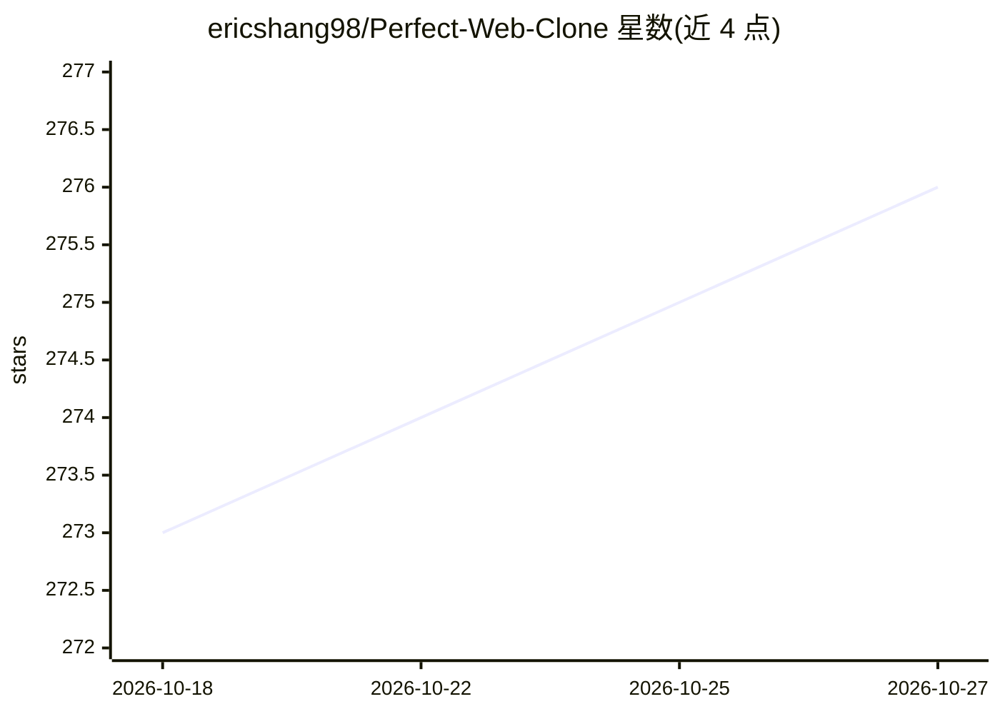

# ericshang98/Perfect-Web-Clone

⭐ 276 · Python · MIT · 推送 2026-08-22 · [GitHub](https://github.com/ericshang98/Perfect-Web-Clone) · 个人维护 · 中文 README

**网页像素级克隆技能：输入 URL 生成带评分的 Vite+React 复刻**

面向编码 agent 的技能/工具集：一条 clone 命令驱动 agent 完成网页抓取、分区规划、React 代码生成、构建与基于度量的修复循环，产出本地预览的 Vite+React 副本。核心的"手与眼"（pwc 命令）为确定性操作，不调用模型；agent 负责编写代码与修复评分最差的区块。完成以评分门控表判定，输出 ready_for_user_review 或 failed_with_residuals。需 Python 3.10+ 与 Node 20+，WebGL 等运行时绘制内容的视觉上限会预先报告。

## 筛选速览

| 维度 | 判定 | 备注 |
|---|---|---|
| AI 角色 | `ai-ecosystem` | LLM/agent 周边工具 |
| 许可风险 | `permissive` | MIT |
| 部署形态 | `library` | 以包/库形式分发 |
| 模型依赖 | — | README 未给出锁定关系 |
| 硬件要求 | — | 无带数字的原话,不猜 |
| 安装摩擦 | `low` | 无编译、无系统依赖或容器化 |
| 成熟度 | — | 结构信号不足 |

## 能力要点

- capture→plan→React→build→measured repair 的完整克隆流程
- pwc CLI 为确定性操作，不调用模型
- 完成状态由评分门控表判定并附证据，每条命令输出 JSON
- 技能文件发布为 perfect-web-clone-skill，可装载到编码 agent

## 适用场景

- 让编码 agent 把任意网页克隆为可运行的 React 代码
- 需要带度量评分而非截图的网页复刻
- 本地预览并按评分迭代修复克隆页面

## 场景标签

`网页抓取` `代码生成` · 领域:效率与自动化

## 证据(README 行号)

> L3: **Pixel-perfect clones of any webpage.** This repo is the measured core. The product is the skill: an agent harness 
> L17: `skill/SKILL.md` is the harness. Same file is published as `perfect-web-clone-skill`.
> L34: Load `perfect-web-clone-skill` into Claude Code, Codex, or any coding agent that can run `pwc`.

## 星数曲线

2026-10-18 273 → 2026-10-27 276（+3）

---
*卡片 v1 · prompt 1.4 · 生成 2026-10-22 · 置信度 high · 依据 README sha `f7589fffead6` · [字段定义](../../DATASET.md)*
