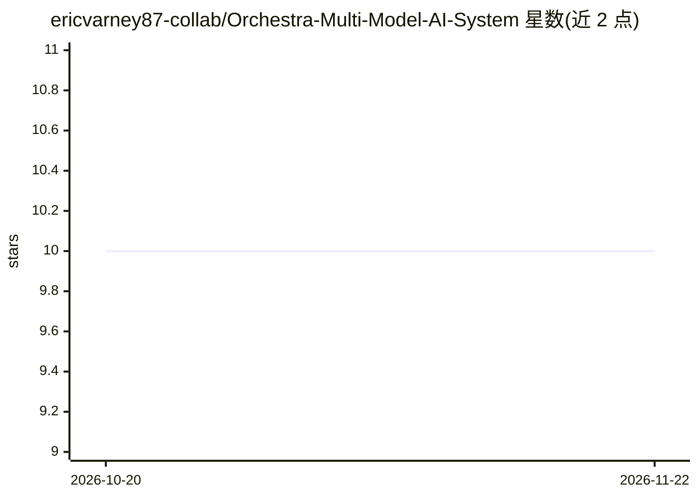

# ericvarney87-collab/Orchestra-Multi-Model-AI-System

⭐ 10 · Python · NOASSERTION · 推送 2026-09-30 · [GitHub](https://github.com/ericvarney87-collab/Orchestra-Multi-Model-AI-System) · 个人维护

**本地多模型编排框架：路由查询到专家小模型并校验答案**

基于 Ollama 的本地多模型编排系统：将查询路由到 18+ 领域专家模型中的 3 个并行生成，检测并惩罚常见推理失败（如力学问题调用宇宙学），并从多视角合成回答。含 RAG 语义记忆、上下文压缩（100+ 轮对话仅用 44% 上下文窗口）、带钓鱼检测的安全浏览器和 DOCX/PPTX/XLSX/PDF 文档生成。技术栈为 Python + Electron + React，需 Python 3.10+、Node.js 18+、Ollama 运行中及 16GB 以上内存，MIT 许可。宣称物理题准确率 75-85%（无校验为 10-15%）。

## 筛选速览

| 维度 | 判定 | 备注 |
|---|---|---|
| AI 角色 | `ai-ecosystem` | LLM/agent 周边工具 |
| 许可风险 | `permissive` | NOASSERTION |
| 部署形态 | `None` |  |
| 模型依赖 | local-ok | 支持本地模型 |
| 硬件要求 | — | 无带数字的原话,不猜 |
| 安装摩擦 | `low` | 无编译、无系统依赖或容器化 |
| 成熟度 | — | 结构信号不足 |

## 能力要点

- 从 18+ 专家模型中自动选 3 个并行路由并合成回答
- 物理答案校验：检测宇宙学误用、因果违反、关键概念缺失
- RAG 语义搜索长期记忆与上下文压缩（100+ 轮对话）
- 100% 本地运行，数据不出机器，MIT 开源

## 适用场景

- 离线环境下用多个小型专家模型回答专业问题
- 需要校验物理/推理类回答可靠性的场景
- 本地私有数据的文档问答与办公文档生成

## 场景标签

`RAG` `Agent 记忆` `文档问答` `AI 助手` · 领域:Agent 开发

## 证据(README 行号)

> L13: - Routing queries to specialized expert models
> L57: - 100% local operation via Ollama

## 星数曲线

2026-10-20 10 → 2026-11-22 10（+0）

---
*卡片 v1 · prompt 1.4 · 生成 2026-11-19 · 置信度 high · 依据 README sha `3138b7068c88` · [字段定义](../../DATASET.md)*
