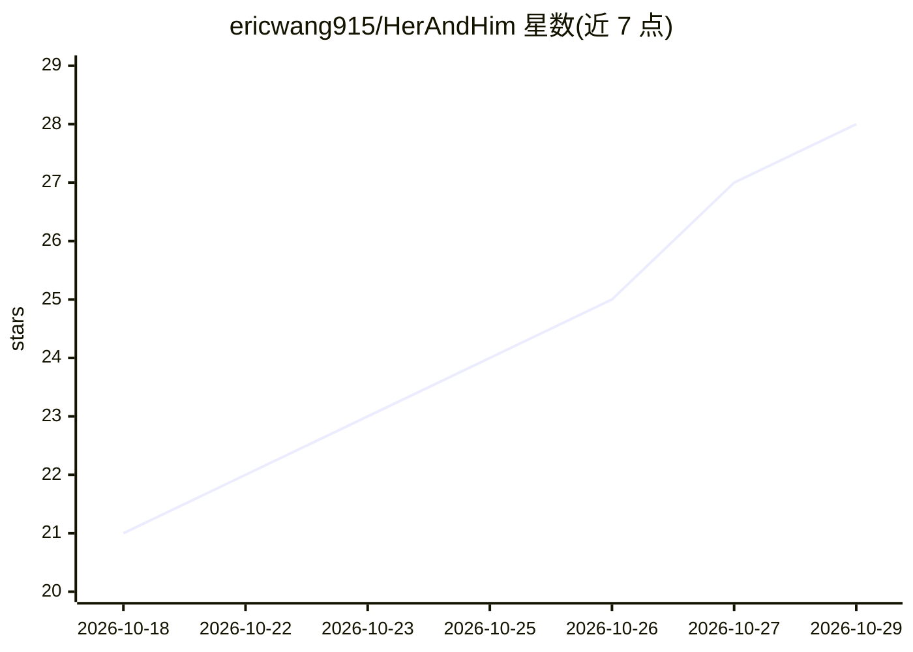

# ericwang915/HerAndHim

⭐ 28 · Python · AGPL-3.0 · 推送 2026-10-07 · [GitHub](https://github.com/ericwang915/HerAndHim) · 个人维护 · 中文 README

**自托管 AI 男/女友伴侣：模拟日常作息、长期记忆、同一张脸的自拍**

面向终端用户的本地自托管 AI 陪伴应用：伴侣角色拥有基于真实城市与天气的日程、长期记忆与情感关系阶段、可主动发起消息；通过规范面部参考生成跨场景同一人像的自拍（13 种图像后端，含本地 ComfyUI / Stable Diffusion WebUI）。对话支持 16 家模型提供商（含 Ollama / LM Studio 全本地），语音输入输出可选 faster-whisper + Piper 本地方案。数据存于本地 SQLite + Markdown，提供 Docker 一条命令运行与 pip/CLI 安装，Web 仪表盘与 Telegram 作为客户端；无官方手机 App，仪表盘自述为早期可用状态。

## 筛选速览

| 维度 | 判定 | 备注 |
|---|---|---|
| AI 角色 | `ai-native` | 本体是模型或模型工具 |
| 许可风险 | `viral` | AGPL-3.0 |
| 部署形态 | `self-host` | docker 或自建部署 |
| 模型依赖 | local-ok | 支持本地模型 |
| 硬件要求 | — | 无带数字的原话,不猜 |
| 安装摩擦 | `low` | 无编译、无系统依赖或容器化 |
| 成熟度 | `idea` | |

## 能力要点

- 16 家 LLM 提供商，其中 Ollama / LM Studio 可全本地无 key 运行
- 13 种图像后端生成同一人像的自拍，照片功能可完全跳过
- 本地语音链路：faster-whisper 语音识别 + Piper 语音合成
- 数据全本地（SQLite + Markdown），Docker 一条命令运行

## 适用场景

- 在自己机器上运行聊天与记忆不出本地的 AI 伴侣
- 通过 Telegram 在手机上与自托管伴侣对话
- 使用本地模型（Ollama）实现零 API 费用的陪伴对话

## 场景标签

`聊天机器人` `图像生成` `语音合成` `语音识别` · 领域:对话与助手

## 证据(README 行号)

> L5:  Self-hosted AI boyfriend / girlfriend — they live a day in a real city,
> L106: Most AI companions answer you. HerAndHim lives a life and texts you like a person.
> L158: |💕 **Boyfriend or girlfriend**|🎭 **Three-layer identity** (soul · persona · profile)|🧠 **16 model providers** (Ope

## 星数曲线

2026-10-18 21 → 2026-10-29 28（+7）

---
*卡片 v1 · prompt 1.4 · 生成 2026-10-27 · 置信度 high · 依据 README sha `d603948c36bb` · [字段定义](../../DATASET.md)*
