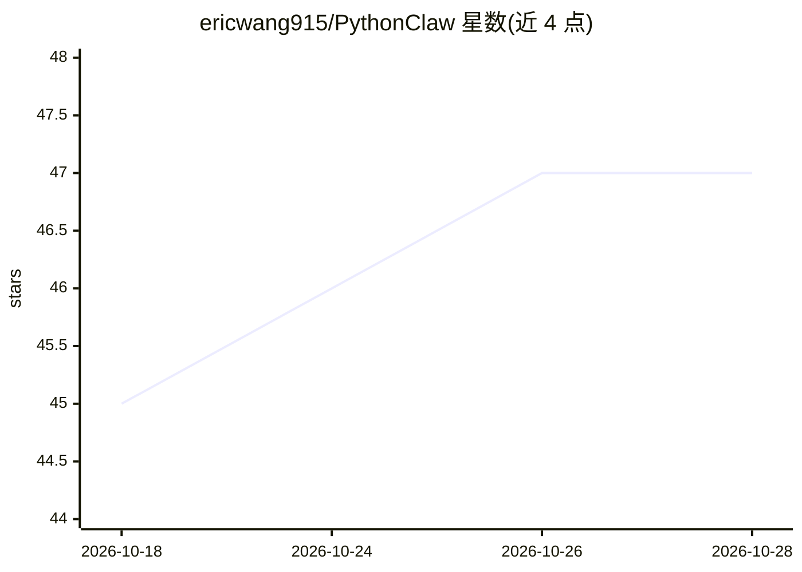

# ericwang915/PythonClaw

⭐ 47 · Python · MIT · 推送 2026-10-06 · [GitHub](https://github.com/ericwang915/PythonClaw) · [官网](https://pypi.org/project/pythonclaw/) · 个人维护 · 中文 README

**纯 Python 个人 AI agent：终端/网页/聊天平台对话与定时任务**

OpenClaw 的 Python 重实现：无 Node.js/Rust/C 扩展，pip 安装后以 CLI、守护进程加 Web 仪表盘（localhost:7788）、Telegram/Discord/WhatsApp 多渠道运行同一 agent。支持 DeepSeek、Grok、Claude、Gemini、Kimi、GLM、Ollama 本地或任意 OpenAI 兼容 API。功能含 Markdown 持久记忆、BM25+稠密向量+RRF 融合+LLM 重排的混合 RAG、13K 技能市场 ClawHub 与运行时自写技能、cron 定时任务、Deepgram/本地 Whisper 语音输入、每群组隔离记忆。提供 pip、源码、Docker/compose 三种部署方式，MIT 许可。

## 筛选速览

| 维度 | 判定 | 备注 |
|---|---|---|
| AI 角色 | `ai-native` | 本体是模型或模型工具 |
| 许可风险 | `permissive` | MIT |
| 部署形态 | `self-host` | docker 或自建部署 |
| 模型依赖 | local-ok | 支持本地模型 |
| 硬件要求 | — | 无带数字的原话,不猜 |
| 安装摩擦 | `low` | 无编译、无系统依赖或容器化 |
| 成熟度 | — | 结构信号不足 |

## 能力要点

- 同一 agent 接入 CLI/Web/Telegram/Discord/WhatsApp，各渠道隔离记忆
- 13K 技能 ClawHub 市场，可在运行时自写并安装新技能
- Markdown 长期记忆与混合 RAG（BM25+稠密向量+RRF+LLM 重排）
- Ollama 100% 本地运行，无需 API key

## 适用场景

- 在终端或聊天软件里用同一个个人 AI 助手对话和执行任务
- 让自己的 agent 定时跑任务并主动发消息
- 本地文档做 RAG 问答并保留可备份的记忆

## 场景标签

`Agent 记忆` `AI 助手` `RAG` · 领域:Agent 开发

## 证据(README 行号)

> L5:  A personal AI agent you own — in pure Python.
> L37: - 📡 **One agent, everywhere** — the same brain answers from your CLI, a browser dashboard, and group chats, each wi
> L76: |📡|**Multi-channel**|CLI, Web, Telegram, Discord, WhatsApp — one agent behind every front-end|

## 星数曲线

2026-10-18 45 → 2026-10-28 47（+2）

---
*卡片 v1 · prompt 1.4 · 生成 2026-10-25 · 置信度 mid · 依据 README sha `28a838bbbd4c` · [字段定义](../../DATASET.md)*
