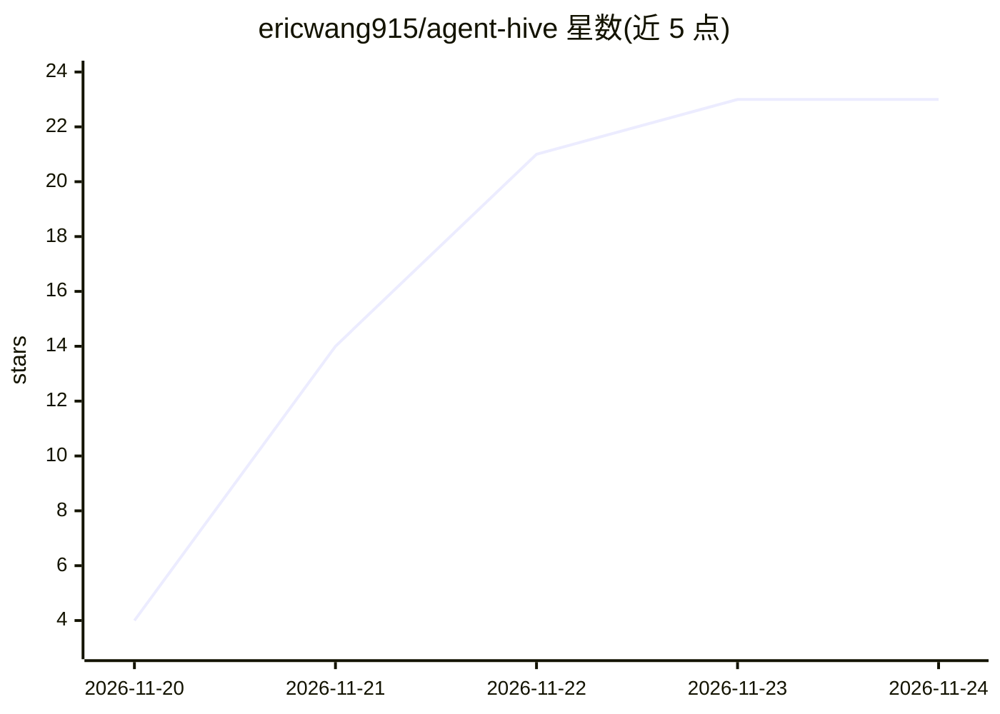

# ericwang915/agent-hive

⭐ 23 · JavaScript · MIT · 推送 2026-11-22 · [GitHub](https://github.com/ericwang915/agent-hive) · [官网](https://ericwang915.github.io/agent-hive/) · 个人维护 · 中文 README

**macOS 桌面应用：统一调度多个 coding agent CLI 协作**

Agent Hive 是一款开源 macOS 应用，把 Claude Code、Codex、Gemini CLI、Antigravity、DeepSeek Harness、Cursor Agent 等 coding-agent CLI 作为"蜜蜂"统一运行：支持定时任务、事件触发、最多六只蜂的接力评审链、Queen 主导的群组分派，以及长期记忆与可复用技能的生成。应用本身不带 API key、无自有服务器，复用用户已有的 CLI 登录与订阅；仅支持 macOS 12+，需要至少一个 agent CLI 在 PATH 上。

## 筛选速览

| 维度 | 判定 | 备注 |
|---|---|---|
| AI 角色 | `ai-ecosystem` | LLM/agent 周边工具 |
| 许可风险 | `permissive` | MIT |
| 部署形态 | `desktop` | 安装包/桌面程序 |
| 模型依赖 | — | README 未给出锁定关系 |
| 硬件要求 | — | 无带数字的原话,不猜 |
| 安装摩擦 | `low` | 无编译、无系统依赖或容器化 |
| 成熟度 | — | 结构信号不足 |

## 能力要点

- 混合编排多种 agent CLI：接力评审、并行 worktree、自动合并
- 定时与事件触发（commits、PR、评论、CI 失败、其他 bee 完成）
- Queen 群组分派与 @mention 路由，无需 API key
- 夜间把对话沉淀为长期记忆与可复用技能

## 适用场景

- 同时管理多个 coding agent 并让它们互相评审代码
- 用定时任务和事件触发让 agent 在我不在时自动工作
- 按每日预算控制 agent 自动运行的 token 开销

## 场景标签

`多智能体` `编码 Agent` · 领域:Agent 开发

## 证据(README 行号)

> L25: Agent Hive is a macOS app that runs several coding-agent CLIs at once and lets them work as a team. Each agent is a
> L27: It uses the CLIs and logins you already have, including a Claude or ChatGPT subscription. It ships no API keys, sto

## 星数曲线

2026-11-20 4 → 2026-11-24 23（+19）

---
*卡片 v1 · prompt 1.4 · 生成 2026-11-21 · 置信度 high · 依据 README sha `a142007e9338` · [字段定义](../../DATASET.md)*
