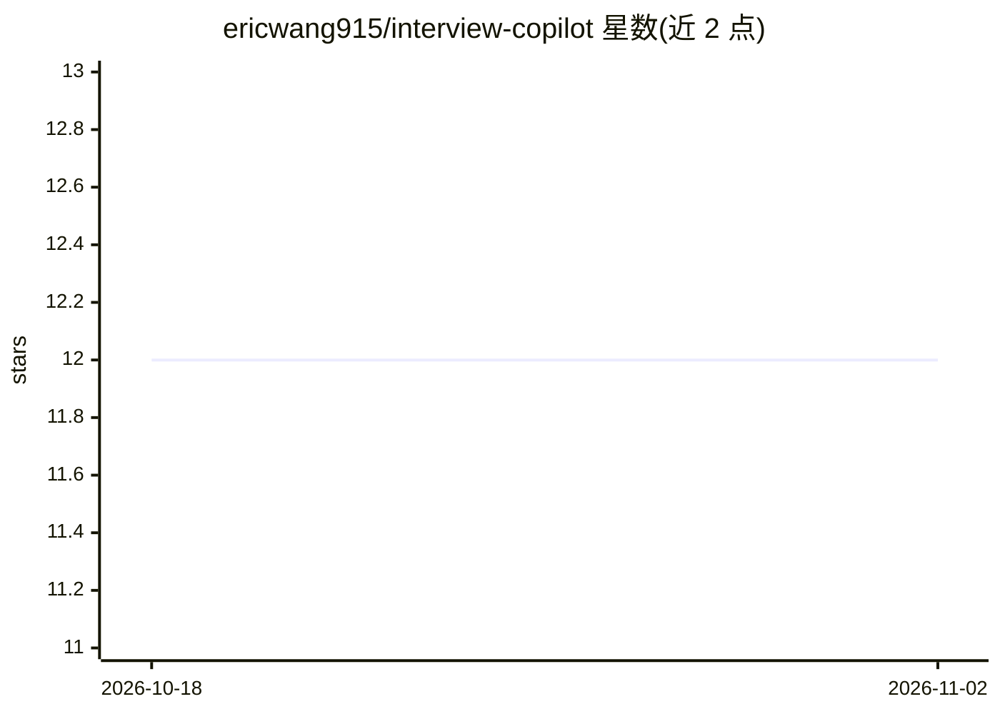

# ericwang915/interview-copilot

⭐ 12 · JavaScript · MIT · 推送 2026-06-09 · [GitHub](https://github.com/ericwang915/interview-copilot) · 个人维护 · 中文 README

**实时面试练习助手：双声道转写+LLM 草拟第一人称答案**

Electron 单窗口桌面应用，面向面试练习与复盘场景：将麦克风（面试者）与系统音频（面试官）分轨转写（音频流至 Deepgram），按热键检测面试官当前问题，调用 DeepSeek/Gemini/OpenAI 或本地 Ollama 生成不超过 500 字的第一人称大纲式答案，上下文取最近约 15 轮对话与用户上传的简历/JD。API key 仅存本地；README 声明真实面试中未经知情使用可能违反公司政策或法律，风险自负。macOS/Windows/Linux 三平台，Releases 提供预构建安装包（未公证）。

## 筛选速览

| 维度 | 判定 | 备注 |
|---|---|---|
| AI 角色 | `ai-native` | 本体是模型或模型工具 |
| 许可风险 | `permissive` | MIT |
| 部署形态 | `desktop` | 安装包/桌面程序 |
| 模型依赖 | local-ok | 支持本地模型 |
| 硬件要求 | — | 无带数字的原话,不猜 |
| 安装摩擦 | `low` | 无编译、无系统依赖或容器化 |
| 成熟度 | — | 结构信号不足 |

## 能力要点

- 双声道分离转写：麦克风=面试者、系统回环=面试官，彩色区分
- 热键（Ctrl+A，可配置）或自动模式检测问题并流式生成答案
- 可切换答案 Provider：DeepSeek/Gemini/OpenAI/本地 Ollama，带重试与模型回退
- 知识库持久化（简历/JD/笔记），答案按目标岗位定制

## 适用场景

- 模拟面试时实时听到问题并生成参考答案
- 面试复盘：结合自己上传的简历与 JD 练习作答
- 希望答案生成完全本地化时选 Ollama 作为 Provider

## 场景标签

`语音识别` · 领域:感知与多模态

## 证据(README 行号)

> L11: > Real-time interview assistant — live dual-channel transcription (Deepgram) + LLM answers (DeepSeek / Gemini / Ope
> L13: A single-window Electron desktop app. It listens to a conversation, separates **you (microphone)** from the **inter
> L25: This tool is built for **interview preparation, practice, self-review, mock interviews, and accessibility assistanc

## 星数曲线

2026-10-18 12 → 2026-11-02 12（+0）

---
*卡片 v1 · prompt 1.4 · 生成 2026-11-01 · 置信度 high · 依据 README sha `b477e1b54698` · [字段定义](../../DATASET.md)*
