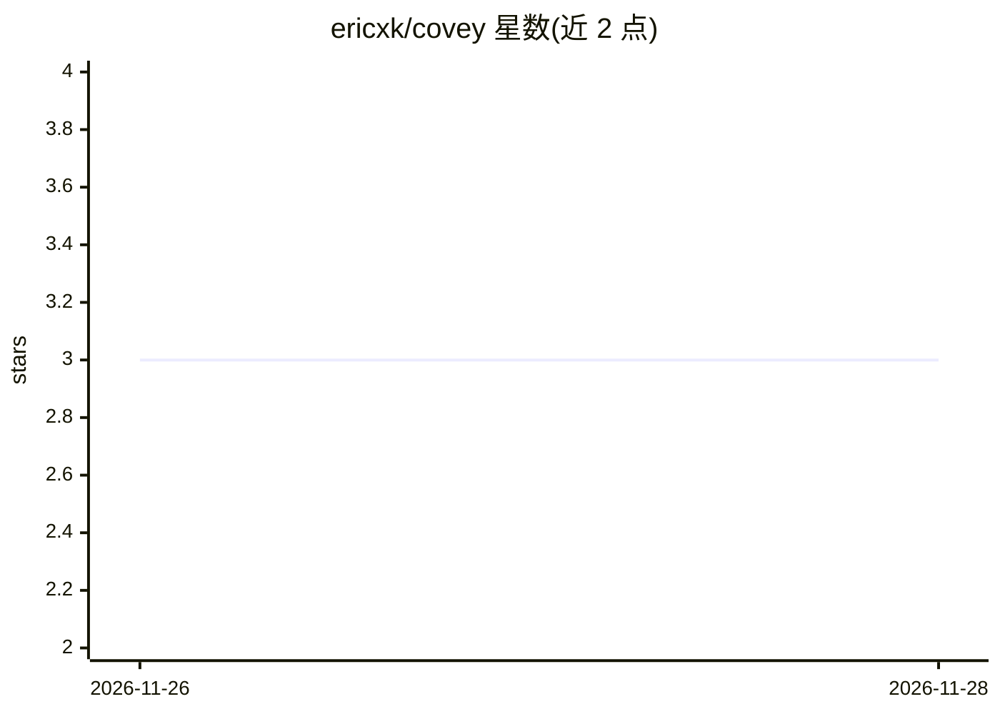

# ericxk/covey

⭐ 3 · Python · MIT · 推送 2026-11-27 · [GitHub](https://github.com/ericxk/covey) · 个人维护 · 中文 README

**在飞书里调度编程 Agent 小队的自托管管家机器人**

以飞书私聊为入口的自托管机器人（Python 3.10+，MIT 许可）：用户一句话派活，管家开话题分派给本机上的 Claude Code、Codex 或 Antigravity，每个话题独立会话与工作区，任务在独立进程中运行，机器人重启、升级、限流后可接续。核心机制包括问题卡拍板、看板、专项负责人、记忆条目、代码改动独立复核与敏感词本机脱敏；另提供可选自托管网页工作台（web/ 源码）与扩展机制。前提为 Linux/macOS、Node.js/npm，且本机已登录至少一个编程 Agent。

## 筛选速览

| 维度 | 判定 | 备注 |
|---|---|---|
| AI 角色 | `ai-ecosystem` | LLM/agent 周边工具 |
| 许可风险 | `permissive` | MIT |
| 部署形态 | `None` |  |
| 模型依赖 | — | README 未给出锁定关系 |
| 硬件要求 | — | 无带数字的原话,不猜 |
| 安装摩擦 | `low` | 无编译、无系统依赖或容器化 |
| 成熟度 | — | 结构信号不足 |

## 能力要点

- 一句话派活：每个话题独立会话、进程与工作区，重启/升级/限流后接续（最长约 3 小时自动重试）
- 一个机器人接 Claude Code、Codex、Antigravity 和 DeepSeek Harness（dsh），聊到一半可换 Harness/模型/工作区
- 问题卡拍板机制：无默认答案，不回答不算同意；看板一张卡看清全部话题状态
- 代码改动支持「独立复核」：换另一家模型只读检查

## 适用场景

- 在飞书私聊里同时管理多个编程 Agent 任务
- 跨几天的长任务交给专项负责人拆活、跟进
- 手机上通过飞书远程盯进度并拍板

## 场景标签

`编码 Agent` `多智能体` · 领域:Agent 开发

## 证据(README 行号)

> L13: 你在飞书私聊里说一句话，管家把活分给 Claude Code、Codex、Antigravity 这些编程 Agent，在你自己的开发机上跑。每件事一个话题、一个会话，进度和结果都在卡片上。机器人重启、模型限流都接得上，要你拍板时
> L51: - **换模型不用重开，换一家来复核。** 一个机器人接 Claude Code、Codex、Antigravity 和 DeepSeek Harness（dsh）；管家和专项负责人能跑在前三个里的任一个上，不绑死某一家。话题聊到
> L144: 核心不按名字引用任何一个 Harness 之外的东西。扩展是一个带清单（`manifest` 模块）的包，放在运行的代码的 `extensions/` 下（固定 release 由 `scripts/deploy_bridge.

## 星数曲线

2026-11-26 3 → 2026-11-28 3（+0）

---
*卡片 v1 · prompt 1.4 · 生成 2026-11-26 · 置信度 high · 依据 README sha `7537b51b64df` · [字段定义](../../DATASET.md)*
