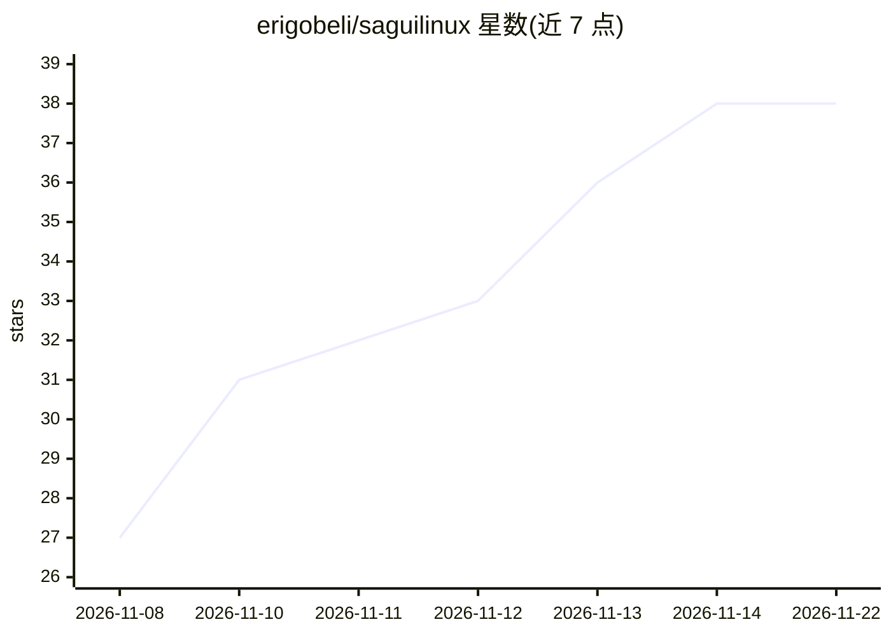

# erigobeli/saguilinux

⭐ 38 · HTML · NOASSERTION · 推送 2026-11-02 · [GitHub](https://github.com/erigobeli/saguilinux) · [官网](https://erigobeli.github.io/saguilinux/) · 个人维护

**由 AI（Claude）按 LFS/BLFS 从零编译的教育性 Linux 发行版**

教育性质的 Linux 发行版项目：不基于任何现成发行版，由 AI agent（Claude Opus 5.5，运行于 Claude Code）依据 Linux From Scratch 12.4 与 BLFS 12.4 图书编写构建脚本，逐包编译约 250 个软件包，产出 XFCE 桌面版（含 Firefox ESR）与终端版两个 live ISO，支持 BIOS+UEFI 从 USB 或虚拟机运行。仓库包含构建脚本、分章节计划、错误记录与文档；人类角色限于定目标、产品决策与实机测试。脚本针对特定路径环境编写，复现需自行适配并在可丢弃的机器/VM 上以 root 运行。

## 筛选速览

| 维度 | 判定 | 备注 |
|---|---|---|
| AI 角色 | `ai-enhanced` | 去掉 AI 部分产品仍成立 |
| 许可风险 | `none` | NOASSERTION |
| 部署形态 | `None` |  |
| 模型依赖 | — | README 未给出锁定关系 |
| 硬件要求 | — | 无带数字的原话,不猜 |
| 安装摩擦 | `low` | 无编译、无系统依赖或容器化 |
| 成熟度 | — | 结构信号不足 |

## 能力要点

- ~250 个包从源码逐个编译，基于 LFS 12.4 + BLFS 12.4
- 提供 XFCE 4.20 桌面版（841 MB）与终端版（295 MB）两个 live ISO
- idempotent 构建驱动（build.sh）在 chroot 内逐包编译并记录日志与错误
- QEMU 自动测试（BIOS/UEFI/USB），截图由 agent 分析

## 适用场景

- 想在虚拟机或 USB 上体验 AI 从零构建的 Linux live 系统
- 学习 LFS/BLFS 的自动化构建流程与脚本组织方式
- 研究 AI agent 执行长周期系统工程任务的实践案例

## 场景标签

`教程课程` · 领域:学习与行业

## 证据(README 行号)

> L28: O **Sagui Linux** é um projeto **educacional**: um sistema operacional Linux montado peça por peça — compilador, bi
> L30: Todo o trabalho técnico foi feito por um agente de IA (**Claude Opus 5.5**, da Anthropic, no **Claude Code**): ler 

## 星数曲线

2026-11-08 27 → 2026-11-22 38（+11）

---
*卡片 v1 · prompt 1.4 · 生成 2026-11-18 · 置信度 high · 依据 README sha `7d2ab8d5a03f` · [字段定义](../../DATASET.md)*
