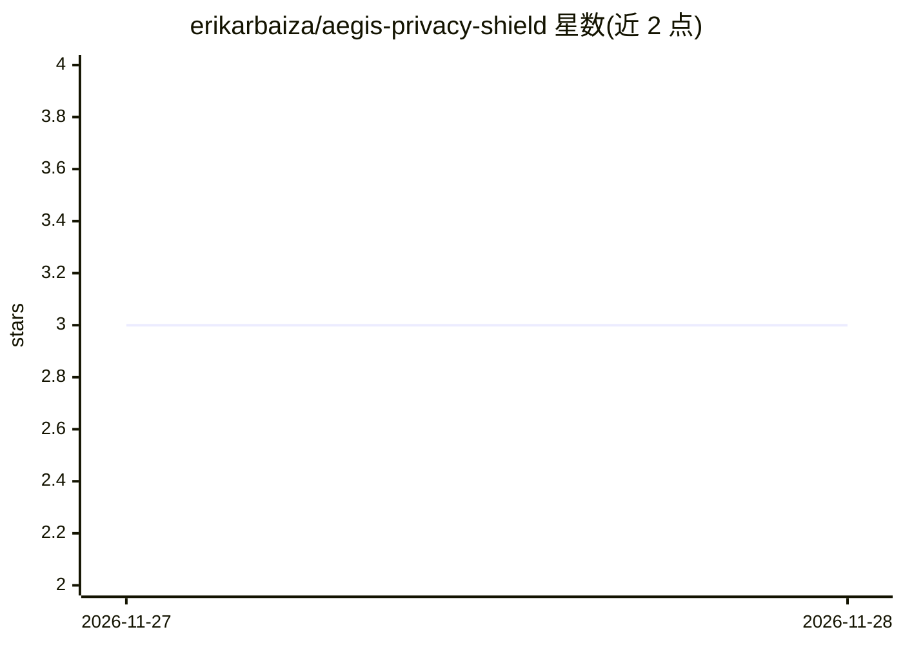

# erikarbaiza/aegis-privacy-shield

⭐ 3 · HTML · MIT · 推送 2026-10-25 · [GitHub](https://github.com/erikarbaiza/aegis-privacy-shield) · [官网](https://erikarbaiza.github.io/aegis-privacy-shield/) · 个人维护

**浏览器扩展：向 ChatGPT/Claude/Gemini 发送前替换个人数据与密钥**

Chrome/Edge 浏览器扩展，在消息发出前把敏感数据替换为占位标签（如 [EMAIL_ADDRESS_1]），AI 回答返回后再在本地还原真实数据。检测在浏览器内完成，无服务器、无账户、无遥测。提供 21 种检测模式，含 8 类个人数据（带 mod-97/Luhn 等校验算法降低误报）、13 类密钥（OpenAI/Anthropic/AWS/Google 等），人名与地址采用基于上下文的近似检测。另有四种保护模式、可信站点豁免、保护历史导出。以 .zip 手动加载方式安装，未上架扩展商店，作者声明为个人测试阶段项目。

## 筛选速览

| 维度 | 判定 | 备注 |
|---|---|---|
| AI 角色 | `ai-ecosystem` | LLM/agent 周边工具 |
| 许可风险 | `permissive` | MIT |
| 部署形态 | `None` |  |
| 模型依赖 | — | README 未给出锁定关系 |
| 硬件要求 | — | 无带数字的原话,不猜 |
| 安装摩擦 | `low` | 无编译、无系统依赖或容器化 |
| 成熟度 | `idea` | |

## 能力要点

- 发送前替换、回答后本地还原的占位符机制
- 21 种检测模式，格式可校验的数据带算法防误报
- 检测全部在浏览器本地完成，无服务器与遥测
- 四种保护模式与保护历史导出（CSV/报告）

## 适用场景

- 在 ChatGPT/Claude/Gemini 中提问时防止误贴邮箱、DNI、IBAN 等个人数据
- 开发者在对话中粘贴代码时防止 API 密钥与 JWT 外泄
- 需要按站点豁免保护或导出保护记录的场景

## 场景标签

`网络安全` · 领域:学习与行业

## 证据(README 行号)

> L3: Extensión de navegador que evita que tus datos personales y tus claves lleguen a ChatGPT, Claude, Gemini o Copilot s
> L5: Antes de que un mensaje salga de tu navegador, AEGIS cambia los datos sensibles por etiquetas (`[EMAIL_ADDRESS_1]`, 
> L74: Todo se procesa en tu navegador. No hay servidor, cuentas, analíticas ni telemetría. El detalle de qué guarda la ex

## 星数曲线

2026-11-27 3 → 2026-11-28 3（+0）

---
*卡片 v1 · prompt 1.4 · 生成 2026-11-27 · 置信度 mid · 依据 README sha `9f5dca72ae81` · [字段定义](../../DATASET.md)*
