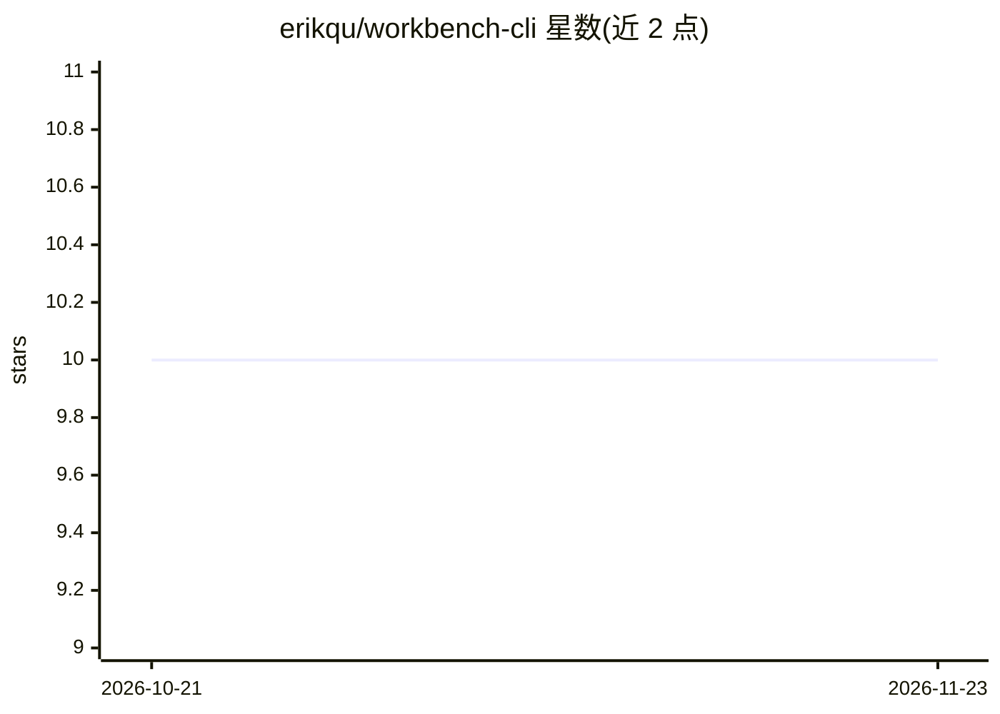

# erikqu/workbench-cli

⭐ 10 · TypeScript · MIT · 推送 2026-11-17 · [GitHub](https://github.com/erikqu/workbench-cli) · [官网](https://ehq.so) · 个人维护

**为开发者在终端并行托管持久 coding-agent 会话的 TUI 工作台**

一个 tmux 驱动的全屏终端工作台，可在独立持久标签页中并行运行多个 coding agent（Codex、Cursor、Claude Code、Gemini、OpenCode），每个工作区提供 agent 与 shell 面板、文件浏览器、实时 Git 变更与多种格式预览。通过私有 tmux socket 保持会话跨重启存活；附 iPhone 原生应用与加密 relay，可远程接入同一批活动会话。通过 curl 安装脚本部署，依赖 Bun，启动时自动检查更新，匿名遥测可用环境变量关闭。

## 筛选速览

| 维度 | 判定 | 备注 |
|---|---|---|
| AI 角色 | `ai-ecosystem` | LLM/agent 周边工具 |
| 许可风险 | `permissive` | MIT |
| 部署形态 | `None` |  |
| 模型依赖 | — | README 未给出锁定关系 |
| 硬件要求 | — | 无带数字的原话,不猜 |
| 安装摩擦 | `low` | 无编译、无系统依赖或容器化 |
| 成熟度 | — | 结构信号不足 |

## 能力要点

- 在独立持久 harness 标签页中并行运行 Cursor、Claude Code、Gemini、Codex、OpenCode
- 私有 tmux 服务器使 agent 与终端跨 Workbench 重启保持存活
- 远程主机 companion 与加密 relay 配合 iPhone 应用接入活动会话
- 终端内预览 Markdown、Mermaid、图片、PDF 与 .blend/.glb 3D 模型

## 适用场景

- 在同一终端里同时运行多个 coding agent 并保持会话不中断
- 通过 iPhone 远程查看和接入开发机上运行中的 agent 会话
- 在一个 TUI 中查看工作区文件、Git 变更并预览产物

## 场景标签

`编码 Agent` · 领域:编码与开发

## 证据(README 行号)

> L47: **A terminal workbench for running coding agents side by side—tmux-backed,
> L64: - Run Cursor, Claude Code, Gemini, Codex, and OpenCode in separate persistent
> L145: Available harness IDs are `codex`, `cursor`, `claude`, `gemini`, and `opencode`.

## 星数曲线

2026-10-21 10 → 2026-11-23 10（+0）

---
*卡片 v1 · prompt 1.4 · 生成 2026-11-19 · 置信度 high · 依据 README sha `44d358d5a3b6` · [字段定义](../../DATASET.md)*
