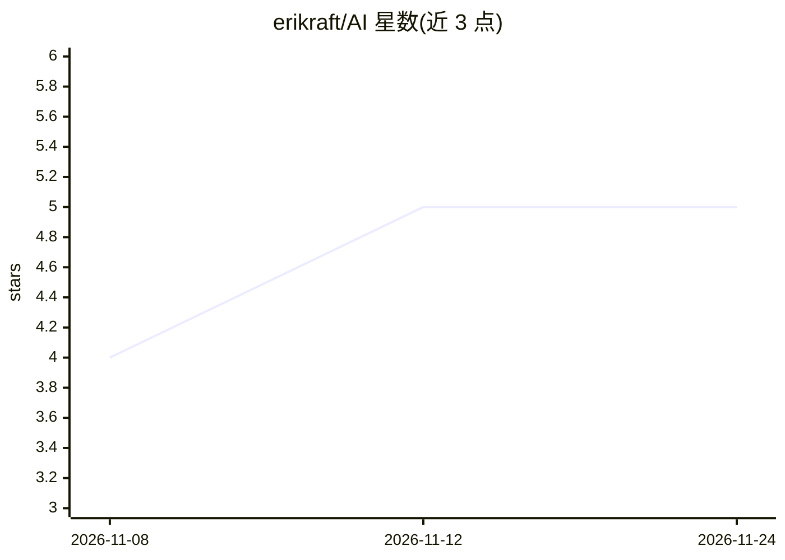

# erikraft/AI

⭐ 5 · JavaScript · MIT · 推送 2026-11-24 · [GitHub](https://github.com/erikraft/AI) · [官网](https://ai.erikraft.com) · 个人维护

**个人 AI 助手网站：文生图/视频/文本/语音克隆聚合中心**

一个部署在 Vercel 上的开源 AI 模型中心，提供葡萄牙语（巴西）/英语双语、深色响应式界面。前端为静态 HTML/CSS/JS，后端为 Node.js Functions，负责 Firebase 身份验证、Firestore 每账户配额管理，再调用 Hugging Face Gradio Spaces 完成推理。文本生成图像用 flux.1dev-abliterated，实验性图像编辑走 Qwythos 解释指令后由 img2img 管线处理，Cosmos 生成视频，Qwen 模型生成文本，XTTS-v2 从参考音频克隆语音。语音克隆先用 Whisper 转写参考音频并检测语言。

## 筛选速览

| 维度 | 判定 | 备注 |
|---|---|---|
| AI 角色 | `ai-native` | 本体是模型或模型工具 |
| 许可风险 | `permissive` | MIT |
| 部署形态 | `library` | 以包/库形式分发 |
| 模型依赖 | — | README 未给出锁定关系 |
| 硬件要求 | — | 无带数字的原话,不猜 |
| 安装摩擦 | `medium` | 含编译或系统依赖之一 |
| 成熟度 | — | 结构信号不足 |

## 能力要点

- 聚合文本生图、图像编辑、视频生成、文本生成与语音克隆多类模型
- Firebase 认证（Google/GitHub/Yahoo/邮箱密码）与 Firestore 每模型每小时配额限制
- Qwythos 图像编辑流程：解释参考图与指令后由 FLUX img2img 生成，强度可配置（0.45–0.85）
- 支持图像转 JSON 视觉蓝图（OCR、布局、颜色、排版与重建提示词）

## 适用场景

- 在带配额管理的网页界面中生成图像与视频
- 上传参考音频克隆多语言语音
- 用参考图加自然语言指令做图像编辑
- 从上传图片生成可复用的 JSON 视觉蓝图

## 场景标签

`AI 助手` `图像生成` `视频生成` `语音合成` · 领域:对话与助手

## 证据(README 行号)

> L1: # ErikrafT AI
> L3: ErikrafT AI is an open-source AI model hub with a responsive dark interface and Portuguese (Brazil)/English UI. This
> L7: - **Generation:** Hugging Face Gradio Spaces route image, video, text, and voice-cloning requests. Voice cloning tra

## 星数曲线

2026-11-08 4 → 2026-11-24 5（+1）

---
*卡片 v1 · prompt 1.4 · 生成 2026-11-21 · 置信度 mid · 依据 README sha `fe83a1cda4ff` · [字段定义](../../DATASET.md)*
