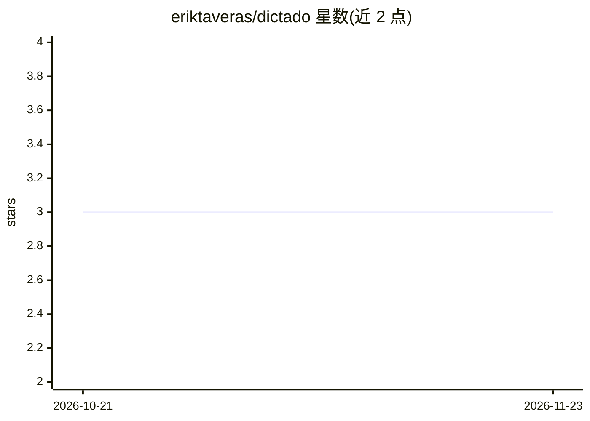

# eriktaveras/dictado

⭐ 3 · Swift · MIT · 推送 2026-10-18 · [GitHub](https://github.com/eriktaveras/dictado) · 个人维护

**给西语用户的 macOS 本地语音听写工具：按键说话即得干净文本**

面向 macOS 的西班牙语语音听写应用：按住 ⌃⇧ 说话，松开后文本粘贴到光标处。转录使用 macOS 26 自带的 SpeechAnalyzer/SpeechTranscriber 引擎，再由本地 Ollama 模型清除口头语、修正标点与大小写，并通过词汇表文件纠正专有名词。音频与文本均不离开本机，无账号与遥测；Ollama 缺失时直接粘贴原始转录。提供 .dmg 安装包与 swiftc 源码构建，另有将口述转为结构化 prompt 的 ⌘ 模式。

## 筛选速览

| 维度 | 判定 | 备注 |
|---|---|---|
| AI 角色 | `ai-native` | 本体是模型或模型工具 |
| 许可风险 | `permissive` | MIT |
| 部署形态 | `desktop` | 安装包/桌面程序 |
| 模型依赖 | local-ok | 支持本地模型 |
| 硬件要求 | — | 无带数字的原话,不猜 |
| 安装摩擦 | `low` | 无编译、无系统依赖或容器化 |
| 成熟度 | — | 结构信号不足 |

## 能力要点

- 按住 ⌃⇧ 即可全局听写，松开后干净文本直接粘贴
- 转录与文本清理全部本地完成，无账号、无遥测
- 词汇表文件纠正 n8n 等技术名词
- ⌘ 模式将口述转换为结构化 AI prompt

## 适用场景

- 在任意输入框用西班牙语快速口述并得到规范文本
- 离线环境下不依赖云服务进行语音听写
- 口述生成结构化 prompt 交给 ChatGPT、Claude 或代码 Agent

## 场景标签

`语音识别` · 领域:感知与多模态

## 证据(README 行号)

> L5:  Mantén ⌃⇧, habla y suelta: el texto aparece donde esté el cursor, ya limpio.
> L18: sea», sin puntuación y destrozando cada nombre técnico. Dictado transcribe en tu
> L105: - **Transcripción:** `SpeechAnalyzer` + `SpeechTranscriber`, el motor de voz que

## 星数曲线

2026-10-21 3 → 2026-11-23 3（+0）

---
*卡片 v1 · prompt 1.4 · 生成 2026-11-22 · 置信度 high · 依据 README sha `009663dabad1` · [字段定义](../../DATASET.md)*
