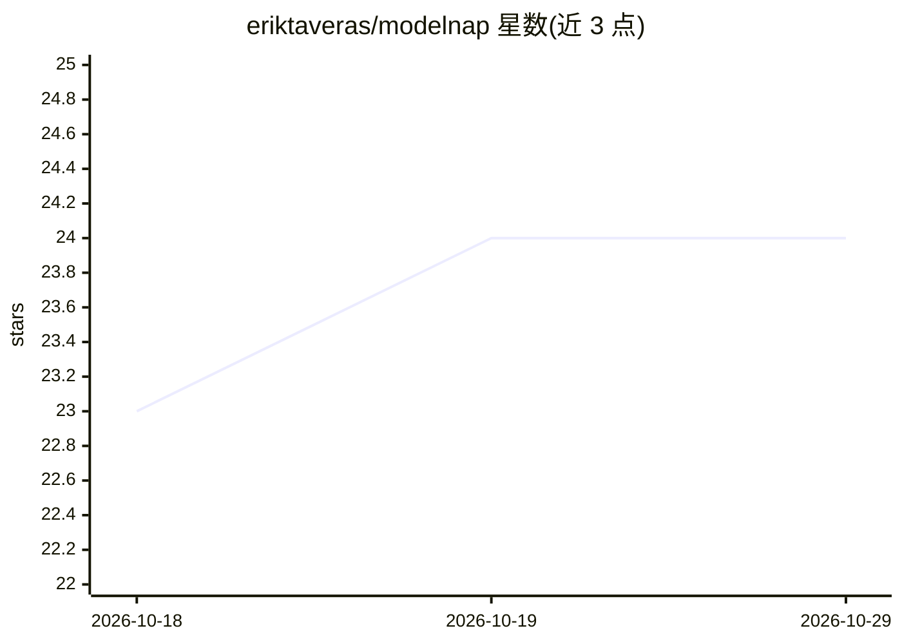

# eriktaveras/modelnap

⭐ 24 · Swift · MIT · 推送 2026-09-27 · [GitHub](https://github.com/eriktaveras/modelnap) · [官网](https://modelnap.com) · 个人维护

**macOS 菜单栏应用：一键开关 Ollama 并自动释放空闲模型内存**

面向本地运行 Ollama 的 Mac 用户的原生菜单栏应用（AppKit + SwiftUI，非 Xcode 工程）。提供一键开关 Ollama（支持 Ollama.app、brew services、LaunchAgent、手动 serve 四种安装方式的检测与正确启停）、空闲 5–60 分钟后自动卸载模型释放 RAM、显示内存占用与已装模型列表、面板或 ⌥⌘O 全局快捷键操作；另支持启停 Splash 并读取其真实内存。只连接本地 Ollama API（127.0.0.1:11434），无账号无遥测。要求 macOS 14 及以上、已安装 Ollama；签名并公证分发 DMG。

## 筛选速览

| 维度 | 判定 | 备注 |
|---|---|---|
| AI 角色 | `ai-ecosystem` | LLM/agent 周边工具 |
| 许可风险 | `permissive` | MIT |
| 部署形态 | `desktop` | 安装包/桌面程序 |
| 模型依赖 | local-ok | 支持本地模型 |
| 硬件要求 | — | 无带数字的原话,不猜 |
| 安装摩擦 | `low` | 无编译、无系统依赖或容器化 |
| 成熟度 | — | 结构信号不足 |

## 能力要点

- 检测 4 种 Ollama 安装机制并以对应方式启停（launchctl/SIGTERM）
- 空闲 5/15/30/60 分钟后自动卸载模型，Ollama 保持运行、下条消息自动重载
- 通过 runner 进程 CPU 时间（proc_pid_rusage）判定模型空闲
- 附带命令行模式（--status/--on/--off）与 IdleTracker 测试

## 适用场景

- 本地大模型不用时把 20–30 GB 内存还回来
- 不想用终端管理 Ollama 启停
- 查看 Mac 内存中模型占用与已装模型（大小/量化/能力标签）

## 场景标签

 · 领域:本地 LLM 管理/系统工具

## 证据(README 行号)

> L42: |🧹|**Frees idle memory**|After 5, 15, 30 or 60 minutes without generating, it unloads the model. Ollama stays on an
> L34: **ModelNap** lets the model sleep when you don't need it and gives you one-click control over Ollama, no Terminal r

## 星数曲线

2026-10-18 23 → 2026-10-29 24（+1）

---
*卡片 v1 · prompt 1.4 · 生成 2026-10-27 · 置信度 high · 依据 README sha `c68da70ecb2c` · [字段定义](../../DATASET.md)*
