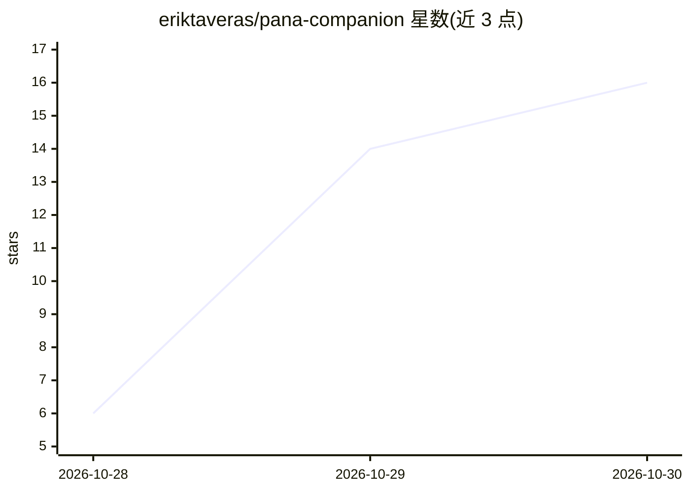

# eriktaveras/pana-companion

⭐ 16 · C · MIT · 推送 2026-10-27 · [GitHub](https://github.com/eriktaveras/pana-companion) · 个人维护

**在 Waveshare 圆屏上给你的 AI 代理一张脸和一副嗓子**

由 ESP32 固件（firmware/，负责显示、触控、麦克风与扬声器）与 Python/FastAPI 服务器（server/，负责 Whisper 语音转文字、调用 Hermes Agent 或任意 OpenAI 兼容 LLM、Piper 文字转语音）组成的语音代理伴侣设备，两者经 WebSocket 协议通信，支持多块板卡同时接入。屏幕实时显示代理所用工具、耗时与需确认的操作，另含 homelab 监控、iCal 日程、YouTube/Instagram 数据与 Obsidian 图谱页面。已支持两款 Waveshare 板卡，需 PlatformIO 编译烧录，附 Claude Code 自定义技能。文档与代码注释为西班牙语。

## 筛选速览

| 维度 | 判定 | 备注 |
|---|---|---|
| AI 角色 | `ai-native` | 本体是模型或模型工具 |
| 许可风险 | `permissive` | MIT |
| 部署形态 | `library` | 以包/库形式分发 |
| 模型依赖 | local-ok | 支持本地模型 |
| 硬件要求 | — | 无带数字的原话,不猜 |
| 安装摩擦 | `low` | 无编译、无系统依赖或容器化 |
| 成熟度 | — | 结构信号不足 |

## 能力要点

- push-to-talk 语音对话：Whisper 转写 + 任意 OpenAI 兼容 LLM/Hermes Agent + Piper 合成
- 屏幕实时显示代理工具调用、状态与耗时，外部操作需触屏确认
- 服务器与板卡经 WebSocket 通信，支持多板同时连接
- 附带 personalizar-pana 技能，可用 Claude Code 修改角色、界面与适配新板卡

## 适用场景

- 给自托管的 AI 代理配一个桌面语音交互终端
- 在圆屏上实时观察代理正在执行的工具与待确认操作
- 顺带监控 homelab 指标、日程和 Obsidian 笔记图谱

## 场景标签

`语音 Agent` · 领域:对话与助手

## 证据(README 行号)

> L5: Mantén pulsado el personaje, habla, y tu agente (Hermes Agent o cualquier LLM compatible con OpenAI) te contesta en 
> L20: - **El cerebro** (`server/`): un servidor en Python que corre en tu ordenador o en tu homelab. Recibe tu voz, la tr

## 星数曲线

2026-10-28 6 → 2026-10-30 16（+10）

---
*卡片 v1 · prompt 1.4 · 生成 2026-10-30 · 置信度 high · 依据 README sha `f6b07770a908` · [字段定义](../../DATASET.md)*
