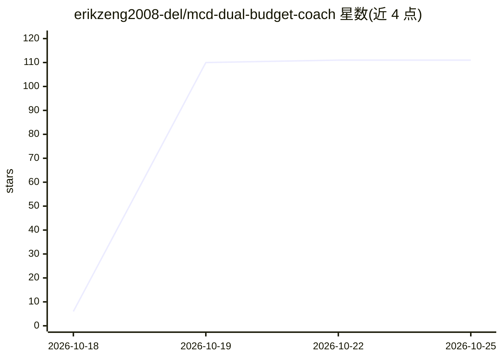

# erikzeng2008-del/mcd-dual-budget-coach

⭐ 111 · HTML · MIT · 推送 2026-10-25 · [GitHub](https://github.com/erikzeng2008-del/mcd-dual-budget-coach) · [官网](https://erikzeng2008-del.github.io/mcd-dual-budget-coach/) · 个人维护 · 中文 README

**麦当劳中国双预算配餐 Agent 技能：钱和热量双闸门配餐**

面向麦当劳中国用户与 WorkBuddy Agent 的 SKILL.md 格式技能：对话中输入预算与热量上限，通过麦当劳 MCP 实时获取菜单、营养与券数据，本地穷举 83 个单品共 88,788 种组合，按双闸门过滤后输出最划算/最扎实/最均衡三档方案，含券后到手价与运动等价换算；组合算法、评分在本地代码执行，不让大模型口算价格。另提供零依赖单文件网页 demo（965KB 轻量版/11MB 完整版）与全息人设卡生成。数据为实测快照，门店固定，只报价不下单。

## 筛选速览

| 维度 | 判定 | 备注 |
|---|---|---|
| AI 角色 | `ai-native` | 本体是模型或模型工具 |
| 许可风险 | `permissive` | MIT |
| 部署形态 | `None` |  |
| 模型依赖 | — | README 未给出锁定关系 |
| 硬件要求 | — | 无带数字的原话,不猜 |
| 安装摩擦 | `low` | 无编译、无系统依赖或容器化 |
| 成熟度 | — | 结构信号不足 |

## 能力要点

- 金额+热量双闸门过滤，本地穷举 88,788 种组合
- 取数走麦当劳 MCP 实时接口（query-meals/list-nutrition-foods/calculate-price），价格实付核验
- 43 项断言自测脚本跑在发货页面文件上，通过 43/失败 0
- 8 种人格 4 档稀有度的全息人设卡，判定规则开源可复算

## 适用场景

- 减脂或控糖时在热量预算内吃麦当劳
- 学生党按金额预算配出券后最划算的组合
- 给孩子配一顿热量可控的开心乐园餐

## 场景标签

`AI 助手` · 领域:对话与助手

## 证据(README 行号)

> L67: 告诉它「30 块 600 卡，中午想吃点扎实的」，它基于麦当劳官方 MCP 实时菜单、营养数据和你的优惠券，配出三个能直接下单的组合——并诚实地告诉你：这顿等于慢跑 50 分钟。
> L104: **关键设计**：取数交给 MCP，**算术交给代码**，表达交给 Agent。菜单、营养、券都是 MCP 实时返回；组合枚举、双闸门过滤、三档评分全在本地算——不让大模型口算价格（点餐场景价格错一位就是事故）。
> L127: 将本仓库的 `SKILL.md` 放入 WorkBuddy 技能目录（或在对话中直接粘贴给 AI 加载）。详细步骤参考 WorkBuddy 官方文档。

## 星数曲线

2026-10-18 6 → 2026-10-25 111（+105）

---
*卡片 v1 · prompt 1.4 · 生成 2026-10-23 · 置信度 high · 依据 README sha `49077478a8e0` · [字段定义](../../DATASET.md)*
