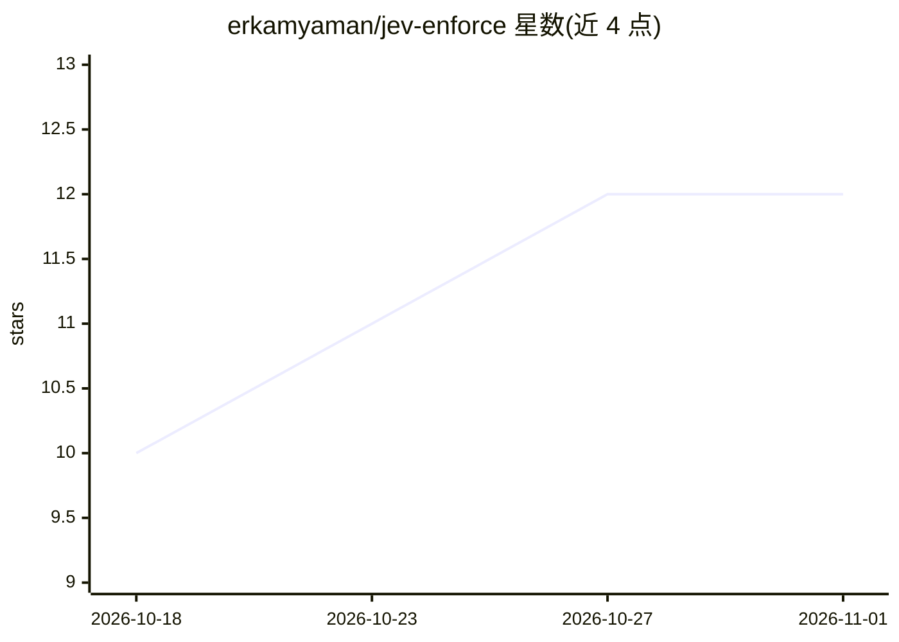

# erkamyaman/jev-enforce

⭐ 12 · TypeScript · MIT · 推送 2026-09-27 · [GitHub](https://github.com/erkamyaman/jev-enforce) · [官网](https://www.npmjs.com/package/jev-enforce) · 个人维护

**校验 Claude Code 回复与编辑是否遵守 CLAUDE.md 规则的插件**

Claude Code 插件，通过 TypeSafe 的 Jev API 以类型化是非题方式逐条检查 Claude 的最终回复与 Edit/Write/MultiEdit 编辑是否符合 CLAUDE.md/AGENTS.md 中的规则；违规以 decision:block 形式带引文返回，促使 Claude 在同轮次内修复。规则读取路径与 Claude Code 自身一致，规则按回复/代码约束分类并缓存。需 Node 18+ 与 TYPESAFE_API_KEY；回答文本、编辑与规则会发送至 TypeSafe API。README 附带基准数据与局限说明（如无法检查依赖 package.json 状态的规则）。

## 筛选速览

| 维度 | 判定 | 备注 |
|---|---|---|
| AI 角色 | `ai-ecosystem` | LLM/agent 周边工具 |
| 许可风险 | `permissive` | MIT |
| 部署形态 | `library` | 以包/库形式分发 |
| 模型依赖 | — | README 未给出锁定关系 |
| 硬件要求 | — | 无带数字的原话,不猜 |
| 安装摩擦 | `low` | 无编译、无系统依赖或容器化 |
| 成熟度 | — | 结构信号不足 |

## 能力要点

- Stop/PostToolUse 钩子逐轮检查回复与文件编辑
- 规则以是非题批量判定，默认阈值 0.7，基准精确率/召回率约 93%
- 违规以 decision:block 返回并引用规则，单轮一次防循环
- 提供独立 CLI，可在 CI 中检查变更文件

## 适用场景

- 让 Claude Code 在编码时持续遵守项目规则
- CI 中对变更文件按规则做检查
- 希望规则被违反时同轮自动修复而不打断会话

## 场景标签

`代码审查` · 领域:编码与开发

## 证据(README 行号)

> L8: Claude Code plugin that checks every reply and every file edit against your CLAUDE.md (or AGENTS.md), using TypeSafe
> L47: - A `Stop` hook checks the final reply. A `PostToolUse` hook checks Edit, Write and MultiEdit.

## 星数曲线

2026-10-18 10 → 2026-11-01 12（+2）

---
*卡片 v1 · prompt 1.4 · 生成 2026-11-01 · 置信度 high · 依据 README sha `bd409551104f` · [字段定义](../../DATASET.md)*
