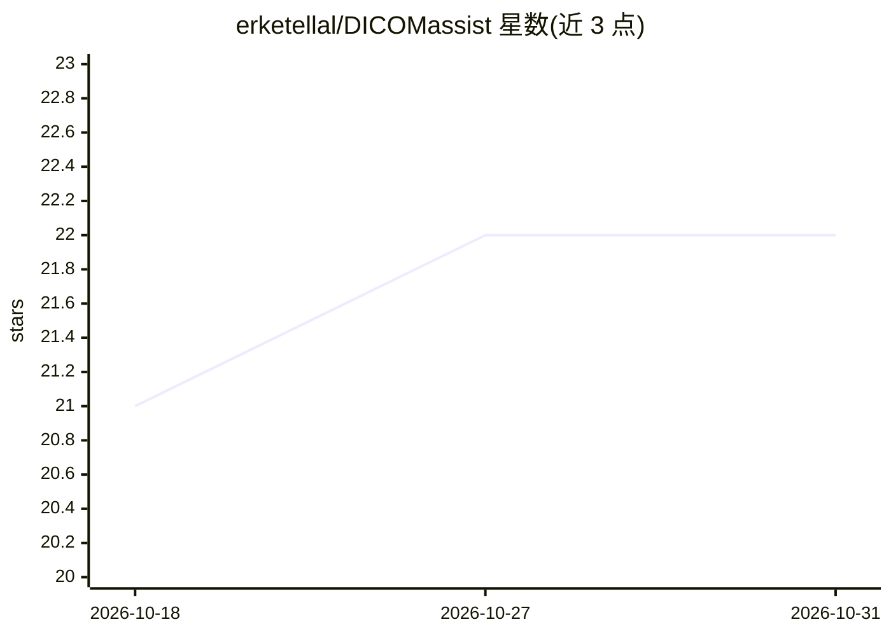

# erketellal/DICOMassist

⭐ 22 · TypeScript · MIT · 推送 2026-10-07 · [GitHub](https://github.com/erketellal/DICOMassist) · [官网](https://dicomassist.dev) · 个人维护

**浏览器内 DICOM 阅览器：AI 选层后送 LLM 做医学影像分析**

面向医学影像的 Web 端 DICOM 阅览器，基于 React 18 与 Cornerstone3D 构建。核心机制为两次调用架构：先让 LLM 读取检查元数据、按临床问题规划最优序列与层厚范围，仅将筛选后的切片送多模态分析，输出带可点击切片引用的发现。支持 1×1 到 2×2 布局与 MPR、窗宽窗位等标准工具。DICOM 文件全部在浏览器本地处理，图像数据仅发送到用户配置的 LLM（Claude API 或经 Ollama 的本地模型）。声明仅供教育科研使用，非认证医疗设备。

## 筛选速览

| 维度 | 判定 | 备注 |
|---|---|---|
| AI 角色 | `ai-native` | 本体是模型或模型工具 |
| 许可风险 | `permissive` | MIT |
| 部署形态 | `library` | 以包/库形式分发 |
| 模型依赖 | local-ok | 支持本地模型 |
| 硬件要求 | — | 无带数字的原话,不猜 |
| 安装摩擦 | `low` | 无编译、无系统依赖或容器化 |
| 成熟度 | — | 结构信号不足 |

## 能力要点

- 两次调用架构：先由 LLM 规划序列与切片范围，再对筛选切片做多模态分析
- DICOM 全程浏览器本地处理，不上传服务器
- 发现结果中的切片引用可点击跳转至对应图像
- 支持 Claude API 与经 Ollama 的本地模型

## 适用场景

- 在浏览器中查看并测量多序列 DICOM 检查
- 让 AI 按临床问题（如 ACL 撕裂分级）筛选关键切片并生成分析
- 用本地模型离线运行影像分析以避免数据外发

## 场景标签

`多模态` · 领域:感知与多模态

## 证据(README 行号)

> L5: Smart slice selection meets multimodal AI analysis. DICOMassist is a web-based DICOM viewer that intelligently selec
> L15: A knee MRI can have 200+ slices across 8+ series. Dumping them all to an AI gives garbage results. DICOMassist uses

## 星数曲线

2026-10-18 21 → 2026-10-31 22（+1）

---
*卡片 v1 · prompt 1.4 · 生成 2026-10-27 · 置信度 high · 依据 README sha `c1019d7f7431` · [字段定义](../../DATASET.md)*
